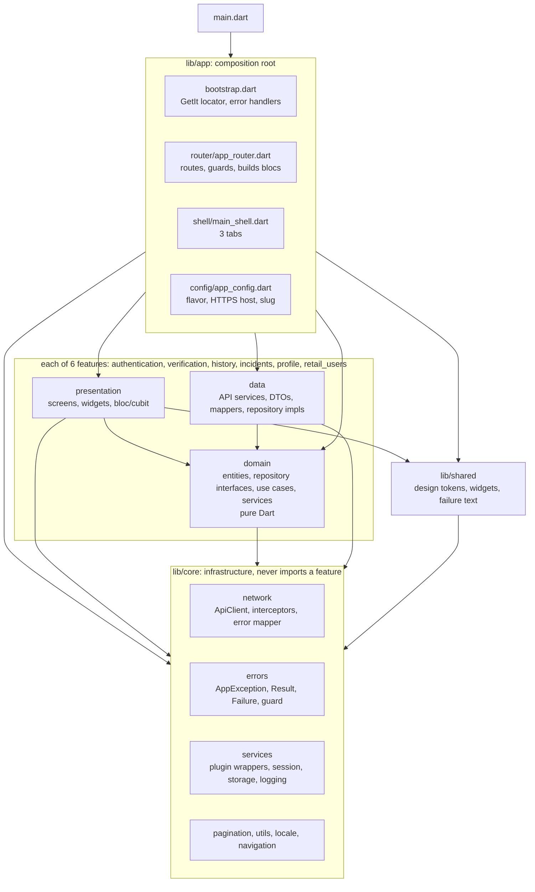

# Production audit

The production-grade review of the app, done on the `production` branch one area at a time. Each area is checked read only first. Its findings are listed here, then fixed one by one on request. Each fix gets its normal, edge and worst-case tests first.

| Step | Area | State |
|---|---|---|
| 2 | High-level architecture | Checked 2026-11-24: P-1 … P-15. Fixed: P-1 … P-9, P-11, P-12; P-10 ready, waits for the Firebase project |
| 3 | The central API | To do |
| 4 | Low-level architecture | To do |
| 5 | Dead code | To do |
| 6+ | Comments, data layer, UI components, state and lifecycle, security, build and release, monitoring, tests, localisation, performance, docs | To do |

**Severity:**
- **must:** a production risk;
- **should:** breaks a rule of `final.md` or makes the code inconsistent;
- **nice:** an improvement.

---

## Step 2: high-level architecture (2026-11-24)

### How it was checked
- A script read every `import` in the 177 hand-written files in `lib/` (799 links, generated files left out). It checked them against the layer rules of `final.md` §3, §4 and §11:

  | Rule | What it checks |
  |---|---|
  | R1, R2 | `core` and `shared` never import a feature or `app` |
  | R3 | a feature never imports `app` |
  | R4 | features don't import one another, except the app-wide profile entity and Cubit (§4) |
  | R5–R7 | `presentation` never imports `data`; `domain` never imports `data` or `presentation`; `data` never imports `presentation` |
  | R8, R9 | `domain` is pure Dart: no Flutter, no Flutter-importing file, no package beyond `meta`, `freezed_annotation`, `json_annotation`, `collection`, `clock`, `timezone`, `intl` |
  | R10 | plugins are used only in `core` |
  | R11 | `get_it` is used only in `app` |
  | R12 | `dio` is used only in `core`, `data` and `app` |
  | R13 | each feature file lives in `data`, `domain` or `presentation` |

- The following were read by hand:
  - the composition root (`lib/app/bootstrap.dart`) and the router (`lib/app/router/`);
  - the config (`lib/app/config/app_config.dart`, `config/*.json`);
  - the error types (`lib/core/errors/`);
  - how each bloc reaches its data;
  - where models are turned into entities;
  - where screens navigate.

### The architecture as it is



**A request and its error, end to end:**

```text
Screen ──event──▶ Bloc/Cubit ──▶ UseCase ──▶ Repository (domain interface)
                                                  │ implemented in data by
                                                  ▼
                                    RepositoryImpl ── guard(() …) ──▶ ApiService ──▶ ApiClient (Dio)
                                                                                      │ interceptors:
                                                                                      │ bodiless → auth (bearer, one renewal)
                                                                                      │ → logging (redacted) → [mock routing]
                                                                                      ▼
                                                                                   server
Answer:  envelope → DTO → mapper → entity → Success(entity) → bloc state → screen
Error:   DioException → error_mapper → AppException (sealed, 15 kinds)
         → guard → Err(Failure) → bloc state → Failure.message(l10n) (shared/extensions)
         or the screen's own text first (e.g. lookupFailureMessage) → screen
```

### What is already production grade (keep)
- **The layer rules hold:**
  - R1–R3 and R5–R13 have **0 breaks**;
  - `domain` is pure Dart in every feature;
  - `presentation` never touches `data`;
  - `core` and `shared` never import a feature;
  - every import uses the `package:` style, with no relative imports.
- **The composition root:** one `GetIt` locator, used only in `lib/app/`. Every service is registered against its interface, and features receive interfaces or callbacks.
- **Plugins:** every plugin sits behind a `core/services` interface. No plugin type (for example `MobileScannerController`) leaks out of `core`, and the tests replace them all with fakes.
- **Errors:**
  - one sealed `AppException` set, one `Result`/`Failure`, and one `guard`, which also turns a wrongly shaped answer into a failure, so no screen waits forever;
  - no `throw` in `domain` or `presentation`;
  - the failure text is central in `shared/extensions/failure_message.dart`, with screen-specific text on top.
- **Global error handlers:** `FlutterError.onError` and `PlatformDispatcher.onError` are set in `bootstrap.dart`.
- **Config:**
  - flavor, host and slug are checked at start;
  - only HTTPS is accepted;
  - the `live` placeholder is refused;
  - Postman mock routing is refused outside the `mock` build.
- **Routing:**
  - route paths are known only to `app/router`, and features use `RouteNames`;
  - the redirect logic is a pure, tested `RouteGuard`;
  - permission-gated paths are guarded, the parameterised session path included.

### Findings

#### P-1 (should): the layer rules are not tested automatically
**Evidence:** the rules above were checked with a one-off script. Nothing in `test/` or CI stops a new import from breaking them.

**Proposal:** an architecture test, `test/architecture/layer_rules_test.dart`. It reads `lib/` and fails on any break of R1–R13, with the allowed exceptions listed in the test itself (the app-wide profile entity and Cubit, §4).

**Tests:**
- **normal:** the current tree passes, except the P-2 link, which is marked as known until P-2 is fixed;
- **edge:** a generated file or an `export` line is handled correctly;
- **worst:** sample files that break each rule are each reported with the file and the rule.

**✅ Fixed 2026-11-24:**
- `test/architecture/layer_rules.dart` (the checker) and `layer_rules_test.dart`, as TC-ARCH-001 … -011 (`docs/test-cases/18-architecture.md`), run in CI with the other tests.
- Beyond the proposal:
  - R8 and R9 follow imports through every file, so a domain file cannot reach Flutter through `core` either;
  - R10 finds plugins from each package's own pubspec, so a new plugin is covered without editing the test;
  - a known break that gets fixed fails TC-ARCH-002 until it is taken off the list.
- **Checked:** a data import planted in `history_bloc.dart` failed TC-ARCH-001, naming the rule, the file and the import.

#### P-2 (should): Profile imports History's `CheckTotalsCubit`
**Evidence:**
- `features/profile/presentation/screens/profile_screen.dart:6` imports `features/history/presentation/bloc/check_totals_cubit.dart`;
- it finds the cubit with `context.read` (line 67) and builds it with `BlocBuilder<CheckTotalsCubit, …>` (line 221);
- the router puts the cubit above the screen only for `history:own`.

This is the only feature-to-feature link outside the allowed profile exception (rule R4, `final.md` §4). It also hides the dependency: nothing in the screen's constructor says it needs it.

**Proposal:** the router builds the totals card from History and hands it to `ProfileScreen` as a slot (for example `Widget? totals`). Profile then knows nothing of History.

**Tests:**
- **normal:** with `history:own` the totals show;
- **edge:** without it there is no card and no `GET checks`;
- **worst:** a failed or `429` totals load shows its message, and the rest of Profile still works.

These run alongside the existing Profile flows, and the P-1 test no longer marks the link as known.

**✅ Fixed 2026-11-24:**
- **Tests first.** The Profile count cases had run only as screenshot tests, which CI skips. They now have CI flow tests in `test/flow/profile_totals_flow_test.dart`, all passing on the old code before the change:
  - TC-PROF-036, -037 and -039, under their existing IDs;
  - TC-PROF-046 … -050, new: a pull asks again; without History a pull does nothing; a 429; a failure keeps the counts; pulls and tab changes while loading send one request.
- **The change:**
  - the card moved to History as `CheckTotalsCard` (`features/history/presentation/widgets/check_totals_card.dart`);
  - `ProfileScreen` takes an optional `totals: (card, refresh)` and no longer looks up a History cubit;
  - the router builds `CheckTotalsCubit` and the card only for `history:own`, as before.
- **Checks:**
  - `knownBreaks` is now empty;
  - TC-ARCH-001 guards the rule from here on;
  - the Profile screenshots are unchanged.
- **Found on the way, for the data-layer step:** after a 429 on the counts, **Try again** sends at once. It doesn't wait out the `Retry-After` that §13.10 asks every 429 to wait.

#### P-3 (should): three verification cubits skip their use cases
**Evidence:**
- every bloc in the app reaches data only through use cases, except `ScanSessionCubit`, `SerialStackCubit` and `SessionsCubit`, which take the `VerificationRepository` itself;
- they call `getFormats` and `session` although use cases for them exist (`GetFormats`, `GetSession`, used elsewhere);
- they also call `scan`, `serials`, `endSession` and `sessions`, which have no use case.

**Proposal:**
- add `ScanItem`, `CheckSerials`, `EndSession` and `GetSessions` to `verification_usecases.dart`;
- have the three cubits take only use cases, so all 14 blocs follow one pattern;
- update the router's wiring.

**Tests:**
- **normal:** a unit test for each new use case;
- **edge:** each one passes its arguments unchanged, including a session ID;
- **worst:** each passes a failure through untouched (a `429` with `Retry-After`, a network loss);
- the existing cubit tests and the scanner, stack and sessions flows pass unchanged.

**✅ Fixed 2026-11-24:**
- **Tests first, both red before the change:**
  - TC-ARCH-012 … -014 (`test/features/verification/domain/verification_usecases_test.dart`), 22 tests:
    - each of the six use cases the cubits use makes its one repository call and returns the answer itself;
    - the arguments pass unchanged: the QR value as read, the session ID, the serial list (same object, order and leading zeros kept), the query and page;
    - a 429 or a lost answer comes back as the same failure, with its reference and wait.
  - A new architecture rule, **R14**, "presentation never imports a repository". It found exactly the three cubits.
- **The change:**
  - `ScanItem`, `CheckSerials`, `EndSession` and `GetSessions` were added to `verification_usecases.dart` and registered in `bootstrap.dart`;
  - `ScanSessionCubit`, `SerialStackCubit` and `SessionsCubit` take only use cases (`GetFormats`, `GetSession` and the four new ones);
  - the router wires them.
- **All 14 blocs now follow one pattern.** `final.md` §4 says so ("use cases only") and points to the architecture test.
- **The existing cubit tests** (`many_items_cubits_test`, `list_waits_test`) changed only how they build the cubits. Their assertions are untouched and they pass.

#### P-4 (should): permission keys are plain text in 25 places
**Evidence:**
- `'item:lookup'`, `'item:bulk_lookup'`, `'history:own'` and `'incident:report'` are written out in `app_router.dart` (6), `main_shell.dart` (6), `profile_screen.dart` (8), `verify_screen.dart` (4) and `lookup_result_screen.dart` (1);
- a typo would compile and silently hide a feature.

**Proposal:**
- one list of the keys in the profile domain;
- plain getters on the profile's permissions (`canLookup`, `canBulkLookup`, `canReadHistory`, `canReport`);
- every place reads those.

**Tests:**
- **normal:** each getter for its key;
- **edge:** an empty set grants nothing, and `history:all` and `retail_user:add` grant nothing (§7);
- **worst:** an unknown key, or a key in a different case, grants nothing;
- the permission flows pass unchanged.

**✅ Fixed 2026-11-24:** the permissions are **typed**, going beyond the proposal.
- **Tests first, both red before the change:**
  - TC-ROLE-021 … -023 (`test/features/profile/domain/permission_test.dart`), through the real mapper:
    - each key grants only its own capability;
    - an empty set, the withdrawn keys and a repeated key grant nothing more;
    - keys in another case, with spaces, a suffix, cut short, empty or unknown grant nothing.
  - TC-ARCH-015, "a permission key is written in one place", found the 25.
- **The change:**
  - a `Permission` enum (`lookup`, `bulkLookup`, `ownHistory`, `report`) with each key written once, in `profile.dart`, the profile entity every feature may already import;
  - `Profile.permissions` is a `Set<Permission>`, filled by the mapper with `Permission.fromKey`, so an unknown key is dropped at the data boundary (§7);
  - `Profile.canLookup`, `canBulkLookup`, `canReadHistory` and `canReport`;
  - the route guard, shell, router, Profile, Check and the result screen read these, so a typo no longer compiles.
- **Also changed:** the router's guard input sorted the permissions, which an enum can't do; it now sorts their names. The staging tool (`tool/staging_check`) keys its route table by `Permission`.
- **Checked:**
  - `route_guard_test` and `main_shell_test` changed only their set literals;
  - the Profile permission rows keep their widget keys;
  - `final.md` §7 says where the keys live.
- **For the dead-code step:** `tabPermissionByPath` in `main_shell.dart` still guards `/home/scan`, a route removed on 2026-11-18.

#### P-5 (should): models become entities in two different ways
**Evidence:**
- history, profile and verification convert in `data/mappers/*_mapper(s).dart` (extensions with `toEntity()`);
- incidents, retail_users and authentication build entities inside the repository (for example `incident_repository_impl.dart:40-43`).

**Proposal:** a `data/mappers/` file for each of the three, so repositories only call, guard and return.

**Tests:**
- **normal:** a mapper unit test for each mapper with a full answer;
- **edge:** optional fields missing or `null`;
- **worst:** an unknown status or role value is never shown as a valid one (§3);
- the repository tests pass unchanged.

**✅ Fixed 2026-11-24:**
- **Tests first.**
  - The mapper tests were red before the change, since the mappers did not exist:
    - TC-REP-070 and -071 (`features/incidents/data/incident_mappers_test`): every field; the time in UTC, an offset and fractions; the note exactly as written; optional fields; an empty last page;
    - TC-REP-073 (`features/retail_users/data/retail_user_mappers_test`): the email as masked, order, names and cursor;
    - TC-AUTH-119 (`features/authentication/data/access_request_mappers_test`): order, names and repeats.
  - TC-REP-072, -074 and TC-AUTH-120 go through the real API service and repository. A time that isn't one, a field of the wrong type, a missing field or a missing list each give a failure, never a wait.
- **The change:**
  - `incidents/data/mappers/incident_mappers.dart`, `retail_users/data/mappers/retail_user_mappers.dart` and `authentication/data/mappers/access_request_mappers.dart`;
  - the three repositories now only call, guard and convert;
  - all six features turn models into entities in `data/mappers/`.
- **Deliberately not moved:** the login answer (`AuthRepositoryImpl._apply`). It isn't a conversion: by `status` it either waits for the emailed code or stores both passes in the session (§6), so it stays in the repository, which owns the session.
- **For step 4 (low level):** `AccessRequestApiService` is a concrete class. Every other API service has an interface and a `Dio…` implementation.

#### P-6 (should): `app_router.dart` does too much (641 lines)
**Evidence:** one file holds:
- the route table;
- the bloc for every route, built from the locator (44 `locator` calls);
- the cross-feature callbacks (result, reports, sessions, profile);
- the pushed-page permission check.

That makes it the largest file in `app/`.

**Proposal:**
- split it by area into `app/router/routes/` (auth, check, history, reports, profile and shell);
- `app_router.dart` keeps only the `GoRouter`, the guard and the list of route groups;
- no change in behaviour.

**Tests:**
- **normal:** a new test lists every `RouteNames` value with its path and checks that each resolves;
- **edge:** the parameterised `/history/sessions/:id`;
- **worst:** a deep link to a gated route without the permission goes Home;
- all router, guard and flow tests pass unchanged.

**✅ Fixed 2026-11-24:**
- **Tests first.** TC-NAV-016 … -018 (`test/flow/route_table_flow_test.dart`), 13 tests, all passing on the old router before anything moved:
  - **the table:** exactly the 16 named routes with their full paths, the top-level order, then the three tabs;
  - **edge:** a session's path with an encoded ID; Reset password without its email; a result without its result;
  - **worst:** gated deep links for an auditor and for a role without History; a logged-out link; an unknown address and its **Try again**.
- **The change:** a script moved each block verbatim into `lib/app/router/routes/`:

  | File | Lines | Holds |
  |---|---|---|
  | `auth_routes.dart` | 152 | splash, login and code, forgot and reset password, request access, change password |
  | `check_routes.dart` | 234 | result, scanner mode, serial stack, the Check tab; the many-items result and the History mapping of a resumed session; `allowsResult` |
  | `history_routes.dart` | 89 | a session's checks, the History tab |
  | `report_routes.dart` | 58 | My reports, a new report |
  | `profile_routes.dart` | 74 | the Profile tab |
  | `route_deps.dart` | 17 | the locator, the profile and the session the groups share |

  `app_router.dart` went from 641 to 170 lines: the `GoRouter`, the guard and its refresh, the check of pushed pages, the "Not available" page and the list of groups.
- **Checked:** no behaviour changed. `final.md` §9 says where the routes live.

#### P-7 (nice): seven plugin wrappers keep the interface and the plugin in one file
**Evidence:**
- `connectivity_service.dart`, `app_info_service.dart`, `launcher_service.dart`, `photo_service.dart`, `permission_service.dart`, `scanner_service.dart` and `preferences_service.dart` each hold the interface and the plugin implementation;
- storage, logging and session keep them in separate files;
- the screens that import the interface (for example `verify_screen.dart` → `scanner_service.dart`) therefore also pull in the plugin's library.

**Proposal:** split each into `<x>_service.dart` (the interface) and `<plugin>_<x>_service.dart` (the implementation), like storage. Only `bootstrap.dart` imports the implementations.

**Tests:**
- a P-1 rule, "presentation and shared import no file that imports a plugin", fails before the split and passes after;
- analyze and all tests pass.

**✅ Fixed 2026-11-24:**
- **Tests first: two architecture rules, red before the change.**
  - **R16:** a `core` file that declares an interface imports no plugin. It found the seven wrappers.
  - **R15:** a `presentation`, `data` or `shared` file reaches no plugin through its imports. It found seven: the report bloc and screen, the result screen, scanner mode, the Check tab, the live camera and `shared/widgets/network_status_banner.dart`.
  - Each rule has a sample break in TC-ARCH-008, the allowed pattern in TC-ARCH-007, and TC-ARCH-016 for its edges: chains, the domain left to R9, `main` and `app`, an interface named only in a comment.
- **The change:** a script split each wrapper, moving the implementation verbatim.

  | Interface (kept) | Implementation (new file) |
  |---|---|
  | `connectivity/connectivity_service.dart` | `plus_connectivity_service.dart` |
  | `device/app_info_service.dart` | `package_info_app_info_service.dart` |
  | `launcher/launcher_service.dart` | `url_launcher_service.dart` |
  | `media/photo_service.dart` (with `PhotoSource`, `PhotoProblem`, `PhotoException`, `PreparedPhoto`) | `image_picker_photo_service.dart` |
  | `permission/permission_service.dart` | `permission_handler_service.dart` |
  | `scanner/scanner_service.dart` (with `ScannerProblem`, `ScannerSession`) | `mobile_scanner_service.dart` |
  | `storage/preferences_service.dart` | `shared_preferences_service.dart` |

  Only `app/bootstrap.dart` and `photo_limit_test` (which tests `ImagePickerPhotoService`'s own helpers) import the implementations. `final.md` §2 states the pattern.
- **Two security tests followed the plugins.** Their rules are unchanged:
  - TC-SEC-009: one file uses `shared_preferences`, and it writes only the language with `setString`;
  - TC-SEC-015: one file uses `url_launcher`, and it opens only `mailto:` and `tel:`.

  They name the new files, and TC-SEC-015 now matches the plugin itself (`package:url_launcher/`, `launchUrl`), not any file whose name mentions it. `bootstrap.dart`'s import of `url_launcher_service.dart` had made it look like a second user. The first full run caught both, 2 failures; the second passed all 1,472.

#### P-8 (nice): `core/network` and `core/services/session` depend on each other
**Evidence:**
- `core/network/auth_interceptor.dart` imports the session interface;
- `core/services/session/dio_session_service.dart` (the Dio implementation of renewal and logout) imports `core/network/api_envelope.dart` and `error_mapper.dart`;
- there is no file cycle, but the two folders depend on each other.

**Proposal:** move `dio_session_service.dart` to `core/network/`, so network depends on the session interface and never the other way.

**Tests:**
- a P-1 rule, "no folder cycle inside `core`", fails before and passes after;
- the session tests (renewal, one renewal for many requests, logout) pass unchanged.

**✅ Fixed 2026-11-24:**
- **Tests first.** A new architecture rule, **R17**, "`core` folders depend on each other in a circle", was red before the change with exactly this circle: `core/network/auth_interceptor.dart` → `core/services/session` → `core/network`.
  - Its sample break is in TC-ARCH-008, and the allowed one-way shape in TC-ARCH-007.
  - TC-ARCH-017 covers its edges: a three-folder circle shown in order, a folder with its subfolder, files of one folder, one way, folders outside `core`.
- **The change:** `dio_session_service.dart` moved (with `git mv`, so it keeps its history) to `core/network/`, beside the envelope and the error mapper it uses. `bootstrap.dart` and three network tests import it from there.
  - `core/network` now depends on `core/services/session` (the interface and the state), never the reverse.
  - `final.md` §4 says so.

#### P-9 (nice): screens navigate in two ways
**Evidence:**
- 8 screens call `go_router` themselves with `RouteNames`: login, forgot and reset password, change password, verify, lookup result, my reports, report incident;
- others get callbacks from the router: scanner mode, serial stack, profile;
- both are allowed (§11), but the rule for choosing between them is not written down.

**Proposal (your decision):**
- write the rule down: a screen may push a `RouteNames` route that needs no object from another feature, and anything that needs one goes through a router callback;
- check the 8 screens against it.

No change is needed where they already comply.

**✅ Fixed 2026-11-24 (the recommendation, on "fix P-9"):**
- **The rule,** now in `final.md` §9:
  - a screen opens its own feature's routes itself, and Home (the app's root) from anywhere;
  - a route of another feature comes through a router callback.
- **Checking the 8 screens found 3 jumps into another feature:**
  - the Check tab's **New report** and **My reports**;
  - the result's **Report a problem**.

  The rest stayed inside their feature. Change password's "go Home" is allowed as Home.
- **Tests first:**
  - TC-NAV-019 … -021 (`test/flow/cross_feature_navigation_flow_test.dart`) passed on the old code: each page opens at its path, the camera waits and resumes after Back, the result's report carries its `check_ref`, there are no report buttons without `incident:report`, and opening and closing in turn ends on Check with its camera;
  - architecture rule **R18** was red with exactly the 3 jumps; TC-ARCH-018 checks that its route table names every route and covers its edges.
- **The change:**
  - `VerifyScreen` takes `onNewReport` and `onMyReports`, beside its existing `onOpenProfile`; the camera still waits for the page to close, since the callbacks return its `Future`;
  - `LookupResultScreen` takes `onReport(checkRef)`;
  - `check_routes.dart` wires them.

#### P-10 (must, your decision): no crash reporting in a release build
**Evidence:**
- `core/services/monitoring/crash_reporting_service.dart` has only the interface and `NoOpCrashReportingService`;
- `bootstrap.dart` always uses the no-op one, so in production, crashes caught by the global handlers are only printed to the phone's log and nobody sees them;
- its comment points to "final.md Section 2.2 / 20.3", which no longer exist.

**Proposal:** choose a service (the comment names Firebase Crashlytics, which needs a Firebase project from Ziska), then implement it behind the existing interface for `staging` and `live`, keeping the no-op one for `mock`. It's handled with the monitoring step, after your choice.

**✅ Code ready 2026-11-24 (your choice: "prepare Crashlytics, off"); switching it on waits for Ziska's Firebase project:**
- **Tests first, all red before the change.** 5 cases, 40 tests:

  | Case | What it checks |
  |---|---|
  | TC-SEC-029 … -031 (`test/app/config/crash_reporting_config_test.dart`) | on only for a complete Firebase app in a staging or live release build; off without values, in debug, or on a platform without its app; a half-filled set or any value in the mock build stops the app at start, naming the missing keys, never a value |
  | TC-SEC-032 (`test/core/services/logging/reported_error_test.dart`) | only an error's type leaves the phone, plus an app error's code, status and reference, never its text |
  | TC-SEC-033 (`test/core/services/monitoring/firebase_crash_reporting_test.dart`) | if Firebase cannot start, the service stays silent and tries once |

  TC-SEC-032 failed on the old code. It sent `Bearer eyJ… raw`, `Text("1000001") overflowed…` and a `FormatException` quoting an answer as they were, which would have broken §12 the day crash reporting went on.
- **The change:**
  - `CrashReportingConfig` and `CrashTarget` in the core interface file;
  - `AppConfig` reads the six `FIREBASE_*` values and offers `crashTargetFor(platform, debug:)`;
  - `ReportedError` in the logging interface;
  - `ConsoleLoggerService` sends a `ReportedError`, first, and its console printing can no longer throw: an error whose text cannot be read is printed without it, a bug the worst-case test found;
  - `FirebaseCrashReportingService`, a plugin file of its own (rules R15 and R16 hold);
  - `bootstrap.dart` picks it only for a target;
  - `firebase_core` 5.1.0 and `firebase_crashlytics` 6.0.1.
- **Checked on 2026-11-24:**
  - the full suite passes, 1,504 tests;
  - the staging release APKs build (arm64 28.1 MB, from 27.9 MB);
  - on the emulator, the x86_64 release APK, without any Firebase value, starts logged in onto the Check tab with its camera;
  - logcat shows no crash, only Firebase's own "initialization unsuccessful" for the app, as no Firebase app is set.
  - The build log shows the Kotlin daemon failing to close its caches for `firebase_core`. That is a known Windows issue when the pub cache (C:) and the project (D:) are on different drives; Gradle compiles without the daemon instead, and the build succeeds.
- **What needs the project:** in `docs/release-backlog.md`: the values, the Crashlytics Gradle plugin (the Android build ID), symbol upload, iOS, the privacy notice.

#### P-12 (must, found 2026-11-24 while fixing P-10): the console log prints errors as they are
**Evidence:**
- `ConsoleLoggerService.warning` and `.error` pass the error object itself to the `logger` package;
- in a release build (level info) it is printed to the phone's log (logcat on Android) with its own text;
- TC-SEC-032's run showed `Bearer eyJ… raw`, `Text("1000001") overflowed…` and a `FormatException` quoting an answer;
- final.md §12: "Never log passwords, emailed codes, phone IDs, passes, lookup values, request bodies, query values".

**Proposal:** for the security step: print an error as a `ReportedError` too (or not at all in release); keep the full error only in debug builds.

**Tests:** normal, edge and worst cases like TC-SEC-032's, on what is printed.

**✅ Fixed 2026-11-24, with a correction:**
- **The evidence above was wrong about release builds.** The `logger` package's default filter (`DevelopmentFilter`) prints only when asserts are on, so a release build printed nothing.
  - This was confirmed twice: by the package source (`logger` 2.8.0) and by P-10's emulator run, where the release app's process wrote no line to logcat.
  - TC-SEC-032 had shown the raw errors in a test, where asserts are on.
- **What was really at risk:**
  1. Release silence rested on that default alone. `Logger.defaultFilter` is a global that any code may change, and one line setting `ProductionFilter` would have printed raw errors in release.
  2. Debug builds, which developers also run against the test server, print errors with their text. That is kept on purpose: developers need it, and it never leaves their machine. Lines stay redacted.
- **Tests first, red before:** TC-SEC-034 … -036 (`test/core/services/logging/console_printing_test.dart`), 7 tests:
  - release prints nothing, while crash reporting still gets its line and type;
  - the package's global default set to print everywhere still prints nothing;
  - debug prints redacted lines, debug lines only when verbose, and never throws.
- **Mutation check:** without the app's switch, the 3 release tests fail and show the raw `FormatException`.
- **The change:**
  - `ConsoleLoggerService` takes `printing` (and an `output` for tests, in place of the unused `logger` parameter) and filters with its own `_Switch`;
  - `bootstrap.dart` passes `printing: kDebugMode`;
  - `final.md` §12 states it.

#### P-11 (should, later): comments point to sections of `final.md` that no longer exist
**Evidence:**
- 197 "Section N.N" references in 116 files of `lib/`;
- about 133 of them name a section that `final.md` no longer has (for example `bootstrap.dart:62`, "Sections 4.2, 5.9"; `final.md` now has §4 and §5 with no subsections);
- the trace from the code to the spec is broken.

**Proposal:** handled in the **comments step**. Each reference is pointed at the current section, or replaced with the backend decision (`D17`, guide §) it really follows.

**✅ Fixed 2026-11-24 (brought forward from the comments step):**
- **Measured:**
  - 217 citations of `final.md` in 117 files, 144 of them (in 86 files) to sections of `final.md` v1.6's numbering (`docs/archive/app-architecture-1.6.md`);
  - 11 audit findings cited without their audit;
  - 2 comments still describing "registrations added per build step";
  - all 55 citations of the app API guide were valid.
- **Test first:** TC-ARCH-019 … -021 (`test/architecture/doc_references_test.dart`, with `doc_references.dart`), red before. They read every comment in `lib/`: `final.md §N` and `Section N`, the API guide, the build guide and the UI audit; bare `§`, lists and ranges.
- **The change:**
  - a script mapped every old number by topic: for example 5.4 Error Flow → §3, 5.7 Feature services → §15, 5.9 Registration → §11, 9.4 Route Guard → §9, 13.1.6 → §13.1, 13.9 Request access → §13.8;
  - it wrote all as `§N` (206 comment lines in 121 files) and named the audit (`UI audit 2026-11-22, N.N`);
  - by hand: three citations split by a line break, 8 lines made too long, the old "Sign up" name in `app_config.dart`, and `bootstrap.dart`'s two build-step comments;
  - 13.3 (now Serial stacks) was checked and is right.
- **Checked:** only comment lines changed (no code line in the diff).

#### P-13 (should, found while fixing P-2): the Profile counts' Try again does not wait out a 429
**Evidence:** after a 429 on `GET checks?limit=1`, **Try again** (and a pull, and the tab coming back) send again at once (`CheckTotalsCubit.load`). final.md §13.10: every 429 waits its own `Retry-After`.

**Proposal:** wait as the lists do (`core/pagination/wait_timer.dart`): nothing is sent during the wait, and it loads once when the wait ends. Without `Retry-After`, a manual retry, with no made-up wait.

#### P-14 (should, found while fixing P-5): `AccessRequestApiService` has no interface
**Evidence:** every other API service is an `abstract interface class` with a `Dio…` implementation; this one is a concrete class.

**Proposal:** the same pattern, guarded by a new architecture rule.

#### P-15 (should, found while fixing P-4): the tab guard still names `/home/scan`
**Evidence:** `tabPermissionByPath` in `app/shell/main_shell.dart` guards `/home/scan`, a route removed on 2026-11-18.

**Proposal:** remove it; a test checks every guarded path is a real route.

### Noticed for later steps (not architecture)
- `config/live.json` still holds placeholders. The app correctly refuses to start with them, but the live host and slug are needed from the backend (**build and release** step).
- There are empty folders in the working tree, not in git: `features/incidents/data/mappers`, `features/incidents/presentation/widgets` and `features/retail_users/presentation/screens` (**dead code** step).
- The release build is signed with the debug key (**build and release** step).
