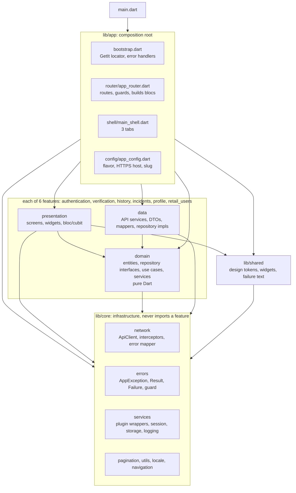

# Production audit

The production-grade review of the app, done on the `production` branch one area at a time. Each area is checked read only first. Its findings are listed here, then fixed one by one on request. Each fix gets its normal, edge and worst-case tests first.

| Step | Area | State |
|---|---|---|
| 2 | High-level architecture | Checked 2026-11-24: P-1 … P-15. **All fixed**; P-10 on for staging, live waits for its production project |
| 3 | The central API | Checked 2026-11-24: P-16 … P-19 (P-16 follows up step 2's P-11). **All fixed** (2026-11-25) |
| 4 | Low-level architecture | Checked 2026-11-25: P-20 … P-45. Fixed: P-20 … P-45 |
| 5 | Dead code | Checked 2026-11-25: P-46 … P-53. **All fixed** (2026-11-26) |
| 6 | Comments | Checked 2026-11-26: P-54 … P-61. Fixed: P-54 … P-58 |
| 7+ | Data layer, UI components, state and lifecycle, security, build and release, monitoring, tests, localisation, performance, docs | To do |

**Severity:**
- **must:** a production risk;
- **should:** breaks a rule of `final.md` or makes the code inconsistent;
- **nice:** an improvement.

---

## Step 2: high-level architecture (2026-11-24)

### How it was checked
- A script read every `import` in the 177 hand-written files in `lib/` (799 links, generated files left out). It checked them against the layer rules of `final.md` §3, §4 and §11:

  | Rule | What it checks |
  |---|---|
  | R1, R2 | `core` and `shared` never import a feature or `app` |
  | R3 | a feature never imports `app` |
  | R4 | features don't import one another, except the app-wide profile entity and Cubit (§4) |
  | R5–R7 | `presentation` never imports `data`; `domain` never imports `data` or `presentation`; `data` never imports `presentation` |
  | R8, R9 | `domain` is pure Dart: no Flutter, no Flutter-importing file, no package beyond `meta`, `freezed_annotation`, `json_annotation`, `collection`, `clock`, `timezone`, `intl` |
  | R10 | plugins are used only in `core` |
  | R11 | `get_it` is used only in `app` |
  | R12 | `dio` is used only in `core`, `data` and `app` |
  | R13 | each feature file lives in `data`, `domain` or `presentation` |

- The following were read by hand:
  - the composition root (`lib/app/bootstrap.dart`) and the router (`lib/app/router/`);
  - the config (`lib/app/config/app_config.dart`, `config/*.json`);
  - the error types (`lib/core/errors/`);
  - how each bloc reaches its data;
  - where models are turned into entities;
  - where screens navigate.

### The architecture as it is



**A request and its error, end to end:**

```text
Screen ──event──▶ Bloc/Cubit ──▶ UseCase ──▶ Repository (domain interface)
                                                  │ implemented in data by
                                                  ▼
                                    RepositoryImpl ── guard(() …) ──▶ ApiService ──▶ ApiClient (Dio)
                                                                                      │ interceptors:
                                                                                      │ bodiless → auth (bearer, one renewal)
                                                                                      │ → logging (redacted) → [mock routing]
                                                                                      ▼
                                                                                   server
Answer:  envelope → DTO → mapper → entity → Success(entity) → bloc state → screen
Error:   DioException → error_mapper → AppException (sealed, 15 kinds)
         → guard → Err(Failure) → bloc state → Failure.message(l10n) (shared/extensions)
         or the screen's own text first (e.g. lookupFailureMessage) → screen
```

### What is already production grade (keep)
- **The layer rules hold:**
  - R1–R3 and R5–R13 have **0 breaks**;
  - `domain` is pure Dart in every feature;
  - `presentation` never touches `data`;
  - `core` and `shared` never import a feature;
  - every import uses the `package:` style, with no relative imports.
- **The composition root:** one `GetIt` locator, used only in `lib/app/`. Every service is registered against its interface, and features receive interfaces or callbacks.
- **Plugins:** every plugin sits behind a `core/services` interface. No plugin type (for example `MobileScannerController`) leaks out of `core`, and the tests replace them all with fakes.
- **Errors:**
  - one sealed `AppException` set, one `Result`/`Failure`, and one `guard`, which also turns a wrongly shaped answer into a failure, so no screen waits forever;
  - no `throw` in `domain` or `presentation`;
  - the failure text is central in `shared/extensions/failure_message.dart`, with screen-specific text on top.
- **Global error handlers:** `FlutterError.onError` and `PlatformDispatcher.onError` are set in `bootstrap.dart`.
- **Config:**
  - flavor, host and slug are checked at start;
  - only HTTPS is accepted;
  - the `live` placeholder is refused;
  - Postman mock routing is refused outside the `mock` build.
- **Routing:**
  - route paths are known only to `app/router`, and features use `RouteNames`;
  - the redirect logic is a pure, tested `RouteGuard`;
  - permission-gated paths are guarded, the parameterised session path included.

### Findings

#### P-1 (should): the layer rules are not tested automatically
**Evidence:** the rules above were checked with a one-off script. Nothing in `test/` or CI stops a new import from breaking them.

**Proposal:** an architecture test, `test/architecture/layer_rules_test.dart`. It reads `lib/` and fails on any break of R1–R13, with the allowed exceptions listed in the test itself (the app-wide profile entity and Cubit, §4).

**Tests:**
- **normal:** the current tree passes, except the P-2 link, which is marked as known until P-2 is fixed;
- **edge:** a generated file or an `export` line is handled correctly;
- **worst:** sample files that break each rule are each reported with the file and the rule.

**✅ Fixed 2026-11-24:**
- `test/architecture/layer_rules.dart` (the checker) and `layer_rules_test.dart`, as TC-ARCH-001 … -011 (`docs/test-cases/18-architecture.md`), run in CI with the other tests.
- Beyond the proposal:
  - R8 and R9 follow imports through every file, so a domain file cannot reach Flutter through `core` either;
  - R10 finds plugins from each package's own pubspec, so a new plugin is covered without editing the test;
  - a known break that gets fixed fails TC-ARCH-002 until it is taken off the list.
- **Checked:** a data import planted in `history_bloc.dart` failed TC-ARCH-001, naming the rule, the file and the import.

#### P-2 (should): Profile imports History's `CheckTotalsCubit`
**Evidence:**
- `features/profile/presentation/screens/profile_screen.dart:6` imports `features/history/presentation/bloc/check_totals_cubit.dart`;
- it finds the cubit with `context.read` (line 67) and builds it with `BlocBuilder<CheckTotalsCubit, …>` (line 221);
- the router puts the cubit above the screen only for `history:own`.

This is the only feature-to-feature link outside the allowed profile exception (rule R4, `final.md` §4). It also hides the dependency: nothing in the screen's constructor says it needs it.

**Proposal:** the router builds the totals card from History and hands it to `ProfileScreen` as a slot (for example `Widget? totals`). Profile then knows nothing of History.

**Tests:**
- **normal:** with `history:own` the totals show;
- **edge:** without it there is no card and no `GET checks`;
- **worst:** a failed or `429` totals load shows its message, and the rest of Profile still works.

These run alongside the existing Profile flows, and the P-1 test no longer marks the link as known.

**✅ Fixed 2026-11-24:**
- **Tests first.** The Profile count cases had run only as screenshot tests, which CI skips. They now have CI flow tests in `test/flow/profile_totals_flow_test.dart`, all passing on the old code before the change:
  - TC-PROF-036, -037 and -039, under their existing IDs;
  - TC-PROF-046 … -050, new: a pull asks again; without History a pull does nothing; a 429; a failure keeps the counts; pulls and tab changes while loading send one request.
- **The change:**
  - the card moved to History as `CheckTotalsCard` (`features/history/presentation/widgets/check_totals_card.dart`);
  - `ProfileScreen` takes an optional `totals: (card, refresh)` and no longer looks up a History cubit;
  - the router builds `CheckTotalsCubit` and the card only for `history:own`, as before.
- **Checks:**
  - `knownBreaks` is now empty;
  - TC-ARCH-001 guards the rule from here on;
  - the Profile screenshots are unchanged.
- **Found on the way, for the data-layer step:** after a 429 on the counts, **Try again** sends at once. It doesn't wait out the `Retry-After` that §13.10 asks every 429 to wait.

#### P-3 (should): three verification cubits skip their use cases
**Evidence:**
- every bloc in the app reaches data only through use cases, except `ScanSessionCubit`, `SerialStackCubit` and `SessionsCubit`, which take the `VerificationRepository` itself;
- they call `getFormats` and `session` although use cases for them exist (`GetFormats`, `GetSession`, used elsewhere);
- they also call `scan`, `serials`, `endSession` and `sessions`, which have no use case.

**Proposal:**
- add `ScanItem`, `CheckSerials`, `EndSession` and `GetSessions` to `verification_usecases.dart`;
- have the three cubits take only use cases, so all 14 blocs follow one pattern;
- update the router's wiring.

**Tests:**
- **normal:** a unit test for each new use case;
- **edge:** each one passes its arguments unchanged, including a session ID;
- **worst:** each passes a failure through untouched (a `429` with `Retry-After`, a network loss);
- the existing cubit tests and the scanner, stack and sessions flows pass unchanged.

**✅ Fixed 2026-11-24:**
- **Tests first, both red before the change:**
  - TC-ARCH-012 … -014 (`test/features/verification/domain/verification_usecases_test.dart`), 22 tests:
    - each of the six use cases the cubits use makes its one repository call and returns the answer itself;
    - the arguments pass unchanged: the QR value as read, the session ID, the serial list (same object, order and leading zeros kept), the query and page;
    - a 429 or a lost answer comes back as the same failure, with its reference and wait.
  - A new architecture rule, **R14**, "presentation never imports a repository". It found exactly the three cubits.
- **The change:**
  - `ScanItem`, `CheckSerials`, `EndSession` and `GetSessions` were added to `verification_usecases.dart` and registered in `bootstrap.dart`;
  - `ScanSessionCubit`, `SerialStackCubit` and `SessionsCubit` take only use cases (`GetFormats`, `GetSession` and the four new ones);
  - the router wires them.
- **All 14 blocs now follow one pattern.** `final.md` §4 says so ("use cases only") and points to the architecture test.
- **The existing cubit tests** (`many_items_cubits_test`, `list_waits_test`) changed only how they build the cubits. Their assertions are untouched and they pass.

#### P-4 (should): permission keys are plain text in 25 places
**Evidence:**
- `'item:lookup'`, `'item:bulk_lookup'`, `'history:own'` and `'incident:report'` are written out in `app_router.dart` (6), `main_shell.dart` (6), `profile_screen.dart` (8), `verify_screen.dart` (4) and `lookup_result_screen.dart` (1);
- a typo would compile and silently hide a feature.

**Proposal:**
- one list of the keys in the profile domain;
- plain getters on the profile's permissions (`canLookup`, `canBulkLookup`, `canReadHistory`, `canReport`);
- every place reads those.

**Tests:**
- **normal:** each getter for its key;
- **edge:** an empty set grants nothing, and `history:all` and `retail_user:add` grant nothing (§7);
- **worst:** an unknown key, or a key in a different case, grants nothing;
- the permission flows pass unchanged.

**✅ Fixed 2026-11-24:** the permissions are **typed**, going beyond the proposal.
- **Tests first, both red before the change:**
  - TC-ROLE-021 … -023 (`test/features/profile/domain/permission_test.dart`), through the real mapper:
    - each key grants only its own capability;
    - an empty set, the withdrawn keys and a repeated key grant nothing more;
    - keys in another case, with spaces, a suffix, cut short, empty or unknown grant nothing.
  - TC-ARCH-015, "a permission key is written in one place", found the 25.
- **The change:**
  - a `Permission` enum (`lookup`, `bulkLookup`, `ownHistory`, `report`) with each key written once, in `profile.dart`, the profile entity every feature may already import;
  - `Profile.permissions` is a `Set<Permission>`, filled by the mapper with `Permission.fromKey`, so an unknown key is dropped at the data boundary (§7);
  - `Profile.canLookup`, `canBulkLookup`, `canReadHistory` and `canReport`;
  - the route guard, shell, router, Profile, Check and the result screen read these, so a typo no longer compiles.
- **Also changed:** the router's guard input sorted the permissions, which an enum can't do; it now sorts their names. The staging tool (`tool/staging_check`) keys its route table by `Permission`.
- **Checked:**
  - `route_guard_test` and `main_shell_test` changed only their set literals;
  - the Profile permission rows keep their widget keys;
  - `final.md` §7 says where the keys live.
- **For the dead-code step:** `tabPermissionByPath` in `main_shell.dart` still guards `/home/scan`, a route removed on 2026-11-18.

#### P-5 (should): models become entities in two different ways
**Evidence:**
- history, profile and verification convert in `data/mappers/*_mapper(s).dart` (extensions with `toEntity()`);
- incidents, retail_users and authentication build entities inside the repository (for example `incident_repository_impl.dart:40-43`).

**Proposal:** a `data/mappers/` file for each of the three, so repositories only call, guard and return.

**Tests:**
- **normal:** a mapper unit test for each mapper with a full answer;
- **edge:** optional fields missing or `null`;
- **worst:** an unknown status or role value is never shown as a valid one (§3);
- the repository tests pass unchanged.

**✅ Fixed 2026-11-24:**
- **Tests first.**
  - The mapper tests were red before the change, since the mappers did not exist:
    - TC-REP-070 and -071 (`features/incidents/data/incident_mappers_test`): every field; the time in UTC, an offset and fractions; the note exactly as written; optional fields; an empty last page;
    - TC-REP-073 (`features/retail_users/data/retail_user_mappers_test`): the email as masked, order, names and cursor;
    - TC-AUTH-119 (`features/authentication/data/access_request_mappers_test`): order, names and repeats.
  - TC-REP-072, -074 and TC-AUTH-120 go through the real API service and repository. A time that isn't one, a field of the wrong type, a missing field or a missing list each give a failure, never a wait.
- **The change:**
  - `incidents/data/mappers/incident_mappers.dart`, `retail_users/data/mappers/retail_user_mappers.dart` and `authentication/data/mappers/access_request_mappers.dart`;
  - the three repositories now only call, guard and convert;
  - all six features turn models into entities in `data/mappers/`.
- **Deliberately not moved:** the login answer (`AuthRepositoryImpl._apply`). It isn't a conversion: by `status` it either waits for the emailed code or stores both passes in the session (§6), so it stays in the repository, which owns the session.
- **For step 4 (low level):** `AccessRequestApiService` is a concrete class. Every other API service has an interface and a `Dio…` implementation.

#### P-6 (should): `app_router.dart` does too much (641 lines)
**Evidence:** one file holds:
- the route table;
- the bloc for every route, built from the locator (44 `locator` calls);
- the cross-feature callbacks (result, reports, sessions, profile);
- the pushed-page permission check.

That makes it the largest file in `app/`.

**Proposal:**
- split it by area into `app/router/routes/` (auth, check, history, reports, profile and shell);
- `app_router.dart` keeps only the `GoRouter`, the guard and the list of route groups;
- no change in behaviour.

**Tests:**
- **normal:** a new test lists every `RouteNames` value with its path and checks that each resolves;
- **edge:** the parameterised `/history/sessions/:id`;
- **worst:** a deep link to a gated route without the permission goes Home;
- all router, guard and flow tests pass unchanged.

**✅ Fixed 2026-11-24:**
- **Tests first.** TC-NAV-016 … -018 (`test/flow/route_table_flow_test.dart`), 13 tests, all passing on the old router before anything moved:
  - **the table:** exactly the 16 named routes with their full paths, the top-level order, then the three tabs;
  - **edge:** a session's path with an encoded ID; Reset password without its email; a result without its result;
  - **worst:** gated deep links for an auditor and for a role without History; a logged-out link; an unknown address and its **Try again**.
- **The change:** a script moved each block verbatim into `lib/app/router/routes/`:

  | File | Lines | Holds |
  |---|---|---|
  | `auth_routes.dart` | 152 | splash, login and code, forgot and reset password, request access, change password |
  | `check_routes.dart` | 234 | result, scanner mode, serial stack, the Check tab; the many-items result and the History mapping of a resumed session; `allowsResult` |
  | `history_routes.dart` | 89 | a session's checks, the History tab |
  | `report_routes.dart` | 58 | My reports, a new report |
  | `profile_routes.dart` | 74 | the Profile tab |
  | `route_deps.dart` | 17 | the locator, the profile and the session the groups share |

  `app_router.dart` went from 641 to 170 lines: the `GoRouter`, the guard and its refresh, the check of pushed pages, the "Not available" page and the list of groups.
- **Checked:** no behaviour changed. `final.md` §9 says where the routes live.

#### P-7 (nice): seven plugin wrappers keep the interface and the plugin in one file
**Evidence:**
- `connectivity_service.dart`, `app_info_service.dart`, `launcher_service.dart`, `photo_service.dart`, `permission_service.dart`, `scanner_service.dart` and `preferences_service.dart` each hold the interface and the plugin implementation;
- storage, logging and session keep them in separate files;
- the screens that import the interface (for example `verify_screen.dart` → `scanner_service.dart`) therefore also pull in the plugin's library.

**Proposal:** split each into `<x>_service.dart` (the interface) and `<plugin>_<x>_service.dart` (the implementation), like storage. Only `bootstrap.dart` imports the implementations.

**Tests:**
- a P-1 rule, "presentation and shared import no file that imports a plugin", fails before the split and passes after;
- analyze and all tests pass.

**✅ Fixed 2026-11-24:**
- **Tests first: two architecture rules, red before the change.**
  - **R16:** a `core` file that declares an interface imports no plugin. It found the seven wrappers.
  - **R15:** a `presentation`, `data` or `shared` file reaches no plugin through its imports. It found seven: the report bloc and screen, the result screen, scanner mode, the Check tab, the live camera and `shared/widgets/network_status_banner.dart`.
  - Each rule has a sample break in TC-ARCH-008, the allowed pattern in TC-ARCH-007, and TC-ARCH-016 for its edges: chains, the domain left to R9, `main` and `app`, an interface named only in a comment.
- **The change:** a script split each wrapper, moving the implementation verbatim.

  | Interface (kept) | Implementation (new file) |
  |---|---|
  | `connectivity/connectivity_service.dart` | `plus_connectivity_service.dart` |
  | `device/app_info_service.dart` | `package_info_app_info_service.dart` |
  | `launcher/launcher_service.dart` | `url_launcher_service.dart` |
  | `media/photo_service.dart` (with `PhotoSource`, `PhotoProblem`, `PhotoException`, `PreparedPhoto`) | `image_picker_photo_service.dart` |
  | `permission/permission_service.dart` | `permission_handler_service.dart` |
  | `scanner/scanner_service.dart` (with `ScannerProblem`, `ScannerSession`) | `mobile_scanner_service.dart` |
  | `storage/preferences_service.dart` | `shared_preferences_service.dart` |

  Only `app/bootstrap.dart` and `photo_limit_test` (which tests `ImagePickerPhotoService`'s own helpers) import the implementations. `final.md` §2 states the pattern.
- **Two security tests followed the plugins.** Their rules are unchanged:
  - TC-SEC-009: one file uses `shared_preferences`, and it writes only the language with `setString`;
  - TC-SEC-015: one file uses `url_launcher`, and it opens only `mailto:` and `tel:`.

  They name the new files, and TC-SEC-015 now matches the plugin itself (`package:url_launcher/`, `launchUrl`), not any file whose name mentions it. `bootstrap.dart`'s import of `url_launcher_service.dart` had made it look like a second user. The first full run caught both, 2 failures; the second passed all 1,472.

#### P-8 (nice): `core/network` and `core/services/session` depend on each other
**Evidence:**
- `core/network/auth_interceptor.dart` imports the session interface;
- `core/services/session/dio_session_service.dart` (the Dio implementation of renewal and logout) imports `core/network/api_envelope.dart` and `error_mapper.dart`;
- there is no file cycle, but the two folders depend on each other.

**Proposal:** move `dio_session_service.dart` to `core/network/`, so network depends on the session interface and never the other way.

**Tests:**
- a P-1 rule, "no folder cycle inside `core`", fails before and passes after;
- the session tests (renewal, one renewal for many requests, logout) pass unchanged.

**✅ Fixed 2026-11-24:**
- **Tests first.** A new architecture rule, **R17**, "`core` folders depend on each other in a circle", was red before the change with exactly this circle: `core/network/auth_interceptor.dart` → `core/services/session` → `core/network`.
  - Its sample break is in TC-ARCH-008, and the allowed one-way shape in TC-ARCH-007.
  - TC-ARCH-017 covers its edges: a three-folder circle shown in order, a folder with its subfolder, files of one folder, one way, folders outside `core`.
- **The change:** `dio_session_service.dart` moved (with `git mv`, so it keeps its history) to `core/network/`, beside the envelope and the error mapper it uses. `bootstrap.dart` and three network tests import it from there.
  - `core/network` now depends on `core/services/session` (the interface and the state), never the reverse.
  - `final.md` §4 says so.

#### P-9 (nice): screens navigate in two ways
**Evidence:**
- 8 screens call `go_router` themselves with `RouteNames`: login, forgot and reset password, change password, verify, lookup result, my reports, report incident;
- others get callbacks from the router: scanner mode, serial stack, profile;
- both are allowed (§11), but the rule for choosing between them is not written down.

**Proposal (your decision):**
- write the rule down: a screen may push a `RouteNames` route that needs no object from another feature, and anything that needs one goes through a router callback;
- check the 8 screens against it.

No change is needed where they already comply.

**✅ Fixed 2026-11-24 (the recommendation, on "fix P-9"):**
- **The rule,** now in `final.md` §9:
  - a screen opens its own feature's routes itself, and Home (the app's root) from anywhere;
  - a route of another feature comes through a router callback.
- **Checking the 8 screens found 3 jumps into another feature:**
  - the Check tab's **New report** and **My reports**;
  - the result's **Report a problem**.

  The rest stayed inside their feature. Change password's "go Home" is allowed as Home.
- **Tests first:**
  - TC-NAV-019 … -021 (`test/flow/cross_feature_navigation_flow_test.dart`) passed on the old code: each page opens at its path, the camera waits and resumes after Back, the result's report carries its `check_ref`, there are no report buttons without `incident:report`, and opening and closing in turn ends on Check with its camera;
  - architecture rule **R18** was red with exactly the 3 jumps; TC-ARCH-018 checks that its route table names every route and covers its edges.
- **The change:**
  - `VerifyScreen` takes `onNewReport` and `onMyReports`, beside its existing `onOpenProfile`; the camera still waits for the page to close, since the callbacks return its `Future`;
  - `LookupResultScreen` takes `onReport(checkRef)`;
  - `check_routes.dart` wires them.

#### P-10 (must, your decision): no crash reporting in a release build
**Evidence:**
- `core/services/monitoring/crash_reporting_service.dart` has only the interface and `NoOpCrashReportingService`;
- `bootstrap.dart` always uses the no-op one, so in production, crashes caught by the global handlers are only printed to the phone's log and nobody sees them;
- its comment points to "final.md Section 2.2 / 20.3", which no longer exist.

**Proposal:** choose a service (the comment names Firebase Crashlytics, which needs a Firebase project from Ziska), then implement it behind the existing interface for `staging` and `live`, keeping the no-op one for `mock`. It's handled with the monitoring step, after your choice.

**✅ Code ready 2026-11-24 (your choice: "prepare Crashlytics, off"); switching it on waits for Ziska's Firebase project:**
- **Tests first, all red before the change.** 5 cases, 40 tests:

  | Case | What it checks |
  |---|---|
  | TC-SEC-029 … -031 (`test/app/config/crash_reporting_config_test.dart`) | on only for a complete Firebase app in a staging or live release build; off without values, in debug, or on a platform without its app; a half-filled set or any value in the mock build stops the app at start, naming the missing keys, never a value |
  | TC-SEC-032 (`test/core/services/logging/reported_error_test.dart`) | only an error's type leaves the phone, plus an app error's code, status and reference, never its text |
  | TC-SEC-033 (`test/core/services/monitoring/firebase_crash_reporting_test.dart`) | if Firebase cannot start, the service stays silent and tries once |

  TC-SEC-032 failed on the old code. It sent `Bearer eyJ… raw`, `Text("1000001") overflowed…` and a `FormatException` quoting an answer as they were, which would have broken §12 the day crash reporting went on.
- **The change:**
  - `CrashReportingConfig` and `CrashTarget` in the core interface file;
  - `AppConfig` reads the six `FIREBASE_*` values and offers `crashTargetFor(platform, debug:)`;
  - `ReportedError` in the logging interface;
  - `ConsoleLoggerService` sends a `ReportedError`, first, and its console printing can no longer throw: an error whose text cannot be read is printed without it, a bug the worst-case test found;
  - `FirebaseCrashReportingService`, a plugin file of its own (rules R15 and R16 hold);
  - `bootstrap.dart` picks it only for a target;
  - `firebase_core` 5.1.0 and `firebase_crashlytics` 6.0.1.
- **Checked on 2026-11-24:**
  - the full suite passes, 1,504 tests;
  - the staging release APKs build (arm64 28.1 MB, from 27.9 MB);
  - on the emulator, the x86_64 release APK, without any Firebase value, starts logged in onto the Check tab with its camera;
  - logcat shows no crash, only Firebase's own "initialization unsuccessful" for the app, as no Firebase app is set.
  - The build log shows the Kotlin daemon failing to close its caches for `firebase_core`. That is a known Windows issue when the pub cache (C:) and the project (D:) are on different drives; Gradle compiles without the daemon instead, and the build succeeds.
- **What needs the project:** in `docs/release-backlog.md`: the values, the Crashlytics Gradle plugin (the Android build ID), symbol upload, iOS, the privacy notice.

**✅ On for staging, 2026-11-24** (the user's Firebase project `ziska-verify`, its staging Android app; Crashlytics only):
- **Tests first:** TC-SEC-037 … -039 (`test/app/config/flavor_configs_test.dart`) read the real config files.
  - TC-SEC-037 was red until `config/staging.json` held the values: staging's Android target has the right shapes.
  - -038 and -039 pin the rest: mock and live report nothing; only `firebase_core` and `firebase_crashlytics`; no Google Services plugin or file; `/firebase/` ignored by git.
- **The change:**
  - the four staging values were copied by a script from `firebase/google-services.json`, which is git-ignored (commit `d9cac13`), without printing the key;
  - live and iOS stay empty.
- **No Gradle plugin:**
  - the Crashlytics Gradle plugin 3.0.8 was tried. With its mapping upload off (that upload needs the Google Services file), it added only an all-zeros mapping ID;
  - FlutterFire itself sets `com.crashlytics.RequireBuildId` to false;
  - so the plugin was reverted, and the test crash proved Crashlytics works without it.
- **The test crash, from a one-off build never committed:** behind `--dart-define=CRASH_TEST=true` it recorded a non-fatal test error, then called `FirebaseCrashlytics.instance.crash()` after 8 s. On the emulator:
  - "Initializing Firebase Crashlytics 21.0.1 for com.ziskapharma.trackandtrace.staging";
  - the server's settings fetched (`collect_reports: true`);
  - `FATAL EXCEPTION … FirebaseCrashlyticsTestCrash`;
  - the report upload to `crashlyticsreports-pa.googleapis.com` answered **Status Code: 200**.

  The normal staging release was then reinstalled: it starts logged in, with Crashlytics initialised and no crash.
- **The Firebase API key in `config/staging.json`:** it is an identifier Google builds into every app, not a secret. Restrict it in Google Cloud to `com.ziskapharma.trackandtrace.staging` and the signing SHA-1; the debug key for now is `63:52:27:0C:56:7C:A9:BA:55:E4:67:6D:60:07:7A:33:A4:0D:66:88`.
- **The key restricted and verified (2026-11-24).** The user restricted it in Google Cloud: "Android apps, 25 APIs", the staging package and the debug key's SHA-1.
  - **The app:** the saved one-off crash-test APK (no code change) ran on the emulator. It recorded a non-fatal error and crashed twice (two launches). Each report was sent through DataTransport with **Status Code 200**, the second by the reinstalled normal build at its start. Logcat shows no 403, `PERMISSION_DENIED`, key or "blocked" error from any Firebase or transport tag.
  - **The key itself:** that run used Firebase Installations' cached ID and Crashlytics' cached settings (made before the restriction), so the restricted call was made directly, as the Android SDK makes it (`POST firebaseinstallations.googleapis.com/v1/projects/ziska-verify/installations`, a fresh random installation ID, the key never printed):

    | Identity sent | Answer |
    |---|---|
    | the staging package and its SHA-1 | **200**, installation registered, token issued |
    | a wrong package | **403** `PERMISSION_DENIED` |
    | no app identity | **403** `PERMISSION_DENIED` |

    The restriction works for the staging app and refuses anyone else. One extra test installation was left in the project; it is harmless.
  - **Afterwards:** the normal staging release reinstalled: Crashlytics initialised, no crash.
  - **For release:** when the real upload key exists, its SHA-1 must be added to this restriction (and to live's own key), or release builds will be refused.

#### P-12 (must, found 2026-11-24 while fixing P-10): the console log prints errors as they are
**Evidence:**
- `ConsoleLoggerService.warning` and `.error` pass the error object itself to the `logger` package;
- in a release build (level info) it is printed to the phone's log (logcat on Android) with its own text;
- TC-SEC-032's run showed `Bearer eyJ… raw`, `Text("1000001") overflowed…` and a `FormatException` quoting an answer;
- final.md §12: "Never log passwords, emailed codes, phone IDs, passes, lookup values, request bodies, query values".

**Proposal:** for the security step: print an error as a `ReportedError` too (or not at all in release); keep the full error only in debug builds.

**Tests:** normal, edge and worst cases like TC-SEC-032's, on what is printed.

**✅ Fixed 2026-11-24, with a correction:**
- **The evidence above was wrong about release builds.** The `logger` package's default filter (`DevelopmentFilter`) prints only when asserts are on, so a release build printed nothing.
  - This was confirmed twice: by the package source (`logger` 2.8.0) and by P-10's emulator run, where the release app's process wrote no line to logcat.
  - TC-SEC-032 had shown the raw errors in a test, where asserts are on.
- **What was really at risk:**
  1. Release silence rested on that default alone. `Logger.defaultFilter` is a global that any code may change, and one line setting `ProductionFilter` would have printed raw errors in release.
  2. Debug builds, which developers also run against the test server, print errors with their text. That is kept on purpose: developers need it, and it never leaves their machine. Lines stay redacted.
- **Tests first, red before:** TC-SEC-034 … -036 (`test/core/services/logging/console_printing_test.dart`), 7 tests:
  - release prints nothing, while crash reporting still gets its line and type;
  - the package's global default set to print everywhere still prints nothing;
  - debug prints redacted lines, debug lines only when verbose, and never throws.
- **Mutation check:** without the app's switch, the 3 release tests fail and show the raw `FormatException`.
- **The change:**
  - `ConsoleLoggerService` takes `printing` (and an `output` for tests, in place of the unused `logger` parameter) and filters with its own `_Switch`;
  - `bootstrap.dart` passes `printing: kDebugMode`;
  - `final.md` §12 states it.

#### P-11 (should, later): comments point to sections of `final.md` that no longer exist
**Evidence:**
- 197 "Section N.N" references in 116 files of `lib/`;
- about 133 of them name a section that `final.md` no longer has (for example `bootstrap.dart:62`, "Sections 4.2, 5.9"; `final.md` now has §4 and §5 with no subsections);
- the trace from the code to the spec is broken.

**Proposal:** handled in the **comments step**. Each reference is pointed at the current section, or replaced with the backend decision (`D17`, guide §) it really follows.

**✅ Fixed 2026-11-24 (brought forward from the comments step):**
- **Measured:**
  - 217 citations of `final.md` in 117 files, 144 of them (in 86 files) to sections of `final.md` v1.6's numbering (`docs/archive/app-architecture-1.6.md`);
  - 11 audit findings cited without their audit;
  - 2 comments still describing "registrations added per build step";
  - all 55 citations of the app API guide were valid.
- **Test first:** TC-ARCH-019 … -021 (`test/architecture/doc_references_test.dart`, with `doc_references.dart`), red before. They read every comment in `lib/`: `final.md §N` and `Section N`, the API guide, the build guide and the UI audit; bare `§`, lists and ranges.
- **The change:**
  - a script mapped every old number by topic: for example 5.4 Error Flow → §3, 5.7 Feature services → §15, 5.9 Registration → §11, 9.4 Route Guard → §9, 13.1.6 → §13.1, 13.9 Request access → §13.8;
  - it wrote all as `§N` (206 comment lines in 121 files) and named the audit (`UI audit 2026-11-22, N.N`);
  - by hand: three citations split by a line break, 8 lines made too long, the old "Sign up" name in `app_config.dart`, and `bootstrap.dart`'s two build-step comments;
  - 13.3 (now Serial stacks) was checked and is right.
- **Checked:** only comment lines changed (no code line in the diff).

#### P-13 (should, found while fixing P-2): the Profile counts' Try again does not wait out a 429
**Evidence:** after a 429 on `GET checks?limit=1`, **Try again** (and a pull, and the tab coming back) send again at once (`CheckTotalsCubit.load`). final.md §13.10: every 429 waits its own `Retry-After`.

**Proposal:** wait as the lists do (`core/pagination/wait_timer.dart`): nothing is sent during the wait, and it loads once when the wait ends. Without `Retry-After`, a manual retry, with no made-up wait.

**✅ Fixed 2026-11-24:**
- **Tests first:**
  - the cubit's TC-PROF-051 … -053 (`test/features/history/check_totals_cubit_test.dart`) were red: no wait existed;
  - the flow's TC-PROF-051 (`test/flow/profile_totals_flow_test.dart`) was red: **Try again** was on and a pull sent at once;
  - TC-PROF-052 (no `Retry-After`: Try again at once) already passed and pins that case.
- **The change:**
  - `CheckTotalsState` has `retryAt` and `isWaiting`;
  - `CheckTotalsCubit` sends nothing during a wait and asks once when it ends, through `WaitTimer` like the lists; it cancels the timer on close;
  - `CheckTotalsCard`'s **Try again** is off while `RetryCountdown` runs.
- **A timing fix in the new test:** "a second 429 starts a new wait" uses a 300 ms wait, so the check falls well inside the second wait. It passed three runs in a row.

#### P-14 (should, found while fixing P-5): `AccessRequestApiService` has no interface
**Evidence:** every other API service is an `abstract interface class` with a `Dio…` implementation; this one is a concrete class.

**Proposal:** the same pattern, guarded by a new architecture rule.

**✅ Fixed 2026-11-24:**
- **Test first:** architecture rule **R19**, "an API service is an interface with a Dio implementation", was red on `access_request_api_service.dart` alone. It has a sample in TC-ARCH-008, the allowed shape in TC-ARCH-007, and TC-ARCH-022 for its edges.
- **The change:**
  - `AccessRequestApiService` is now the interface (its three routes documented), and `DioAccessRequestApiService` the implementation, unchanged inside;
  - `bootstrap.dart`, two tests, a staging replay test and the staging tool build the `Dio…` class;
  - the repository still takes the interface.

#### P-15 (should, found while fixing P-4): the tab guard still names `/home/scan`
**Evidence:** `tabPermissionByPath` in `app/shell/main_shell.dart` guards `/home/scan`, a route removed on 2026-11-18.

**Proposal:** remove it; a test checks every guarded path is a real route.

**✅ Fixed 2026-11-24:**
- **Tests first,** TC-NAV-022 … -024 (`test/flow/route_table_flow_test.dart`):
  - the guard names real routes only;
  - it guards exactly the seven pages that need a permission;
  - `/home/scan` shows "Not available." for every role.

  All were red: the stale entry sent a role without `item:lookup` to Check instead of "Not available.", while a role with it got "Not available.".
- **The change:** the `/home/scan` entry is removed from `tabPermissionByPath`.

### Noticed for later steps (not architecture)
- `config/live.json` still holds placeholders. The app correctly refuses to start with them, but the live host and slug are needed from the backend (**build and release** step).
- There are empty folders in the working tree, not in git: `features/incidents/data/mappers`, `features/incidents/presentation/widgets` and `features/retail_users/presentation/screens` (**dead code** step).
- The release build is signed with the debug key (**build and release** step).

---

## Step 3: the central API (2026-11-24)

### How it was checked
Read only.
- **Every request the app makes** was taken from the seven `features/*/data/services/*_api_service.dart` files and from `core/network/dio_session_service.dart` (the renewal).
- **The comparison:** with the backend's Postman collection (`docs/protectb-api/ProtectB-mobile-app.postman_collection.json`, parsed by a script: method, path, query and body keys) and with the app API guide (`docs/protectb-api/app-api-guide.md` §1, §3–§7).
- **Also read:** `core/network` (`api_client.dart`, `api_envelope.dart`, `error_mapper.dart`, the interceptors), the wiring in `app/bootstrap.dart`, and `android/app/src/main/res/xml/network_security_config.xml`.

### What is already right (keep)

| Check | Result |
|---|---|
| A. One way to the server | Only the seven API services use `ApiClient`. No `Dio(`, `HttpClient`, `package:http`, server URL or `Uri.parse` of the API exists outside `core/network` and `app/`; rules R10, R12 and R15 guard it. The two other network paths are by design: product pictures (`core/services/picture/picture_images.dart`, `https://` with a host only, never through `ApiClient`, so the picture host never gets the pass) and the mail/phone launcher. The renewal uses a second Dio without interceptors (`dio_session_service.dart`), as it must not pass through the auth interceptor it serves; it uses the same envelope and error mapper. |
| B. Routes against the contract | All **23** routes of the collection are the app's, with the same methods, paths and body keys, and the app calls no other. The nine public routes (login, code, resend, forgot, reset, roles, access code, access request; the renewal separately) go without a pass (`skipAuth`). Query parameters match the guide: `checks` (§5), `lookups/sessions` (§4.5), `incidents` (§6.3), `retail-users` (§7.1). `scope` is never sent (a 400 since 2026-11-15); `kind` is an answer field. |
| E. Error mapping | Every `error.code` of guide §1's table has its exception (`error_mapper.dart`). An unknown code or a page without the envelope is decided by status (400/413/415, 403, 404, 429, 503). `Retry-After` is read in seconds and as an HTTP date; a missing or past one gives no made-up wait. |
| F. Timeouts | Connect 15 s, send 60 s, receive 30 s (`api_client.dart`, `DioFactory`): enough for a 1 MB photo and a slow lookup. A connect timeout is "not sent"; a send or receive timeout is "may be recorded" (`NetworkException`), which the screens tell apart (§13.1). |
| G. Retries | Only two: the request after a renewal (once, `auth_interceptor.dart`) and the serial stack's confirmed 503 (once, after one second). A lookup is never sent twice by itself. |
| I. Interceptors | In order: bodiless → Postman mock routing (mock build only, refused elsewhere by `AppConfig`) → auth → logging. `me/password` alone keeps the login on a 401 (`keepSessionOn401`, guide §3.6). |
| J. Logging | Method, path, status and `request_id` only. Query values sit in `queryParameters`, not the path, and are never logged; bodies and headers never are. A release build prints nothing (P-12). |
| K. Headers | JSON `Content-Type` by default. A GET or a bodiless POST sends no `Content-Type` (`BodilessRequestInterceptor`, guide §1); a photo is sent raw with its type and `Content-Length` (guide §6.2). |
| L. Transport | HTTPS only: `AppConfig` refuses any other address, and Android forbids cleartext and trusts the system's certificates. Certificate pinning is for the security step. |

### Findings

#### P-16 (should, follows up P-11): the citation check misses two cases
**Evidence:**
- TC-ARCH-019 reads one line at a time, so a citation split by a line break escapes it. There are 8 in `lib/`, and 6 of them still name an old section:
  - `core/pagination/paginated_state.dart:34` (10.4, 10.6);
  - `core/services/picture/picture_images.dart:16` (12.1);
  - `features/authentication/presentation/bloc/submit_state.dart:17` (15.4);
  - `features/authentication/presentation/screens/request_access_screen.dart:28` (13.9);
  - `features/verification/presentation/models/result_view.dart:4` and `widgets/result_entry_cards.dart:20` (13.1.4);
  - `shared/widgets/failure_banner.dart:9` (15.4).

  `history_screen.dart:27` (13.4) is right.
- It reads only `lib/`. 39 citations of the old numbering remain in `test/`, `tool/` and the Android XML (for example `AndroidManifest.xml:5`, `network_security_config.xml:2`).

**Proposal:** the checker reads a comment block as one text, and checks `test/`, `tool/`, `android/` and `ios/` too. Then the same mapping fixes those citations.

**Tests:**
- **normal:** a citation within one line;
- **edge:** a citation split across two or three comment lines; XML `<!-- -->` comments;
- **worst:** a split citation of a removed section, reported at its first line.

**✅ Fixed 2026-11-24:**
- **Tests first,** TC-ARCH-023 … -025 in `doc_references_test.dart`, red before:
  - a citation split over lines is read as one (Dart, Kotlin, XML);
  - a `//` inside a string, an example between backticks and a finished line are not citations;
  - "test plan Section N" is checked against `docs/test-plan.md`;
  - a split citation that leads nowhere is reported at the line of its `Section` or `§`.

  TC-ARCH-019 now reads `lib/`, `test/`, `tool/`, `android/` and `ios/`. It found **48**: 7 in `lib/`, 5 in the Android project, 36 in the tests.
- **A bug found by the worst case:** the first join trimmed only line ends, so "Section" + "12.1" became `Section  12.1` and still escaped. Each part is now trimmed on both sides.
- **The change:**
  - a second script used P-11's mapping plus 2.3 → §17, 13.4.1 → §13.4, 18.2 → §18, and the checker's rule (a citation belongs to the last document named before it on its line). Its dry run caught two wrong rewrites of a first version: guide citations after a guide named earlier on the line;
  - it rewrote 45 files, and one more by hand (`picture_images.dart`, a split citation with no document named);
  - two citations whose number still exists but changed topic, 13.9 (once Request access, now Screen rules) in `request_access_screen.dart` and `AndroidManifest.xml`, now say §13.8;
  - ten test comments made too long were rewrapped.
- **Checked:** outside the checker itself, only comment lines changed.

#### P-17 (should): route paths are text in eight files
**Evidence:**
- The paths are typed where they are used: `'auth/login'`, `'lookups/sessions/${Uri.encodeComponent(id)}/end'`, `'incidents/$reportId/photos'` … in the seven services and `dio_session_service.dart`.
- Nothing checks them against the contract. A typo is caught only by the flow tests that reach that route.
- Path IDs are encoded in two ways: a session ID with `Uri.encodeComponent`, a report ID by interpolation (an `int`, so safe today).

**Proposal:**
- one `ApiRoutes` in `core/network/`: each route a constant or a function that encodes its IDs, and the services use it;
- a contract test compares `ApiRoutes` with the Postman collection's 23 routes, both ways: methods and paths.

**Tests:**
- **normal:** every route of the collection is in `ApiRoutes` and the reverse;
- **edge:** an ID with `/`, a space or `%` is encoded once;
- **worst:** a route the backend does not have, or a method changed, fails with its name.

**✅ Fixed 2026-11-24:**
- **Tests first:**
  - TC-ARCH-026 … -028 (`test/core/network/api_routes_test.dart`), red before: `ApiRoutes` did not exist. They check:
    - the app's routes equal the Postman collection's 23 both ways;
    - IDs are encoded once;
    - a route of the wrong method is refused before any request;
    - an empty ID is refused;
    - every route declared is in the list.
  - A new architecture rule, **R20**: an `ApiRoute` is made only in `api_routes.dart`.
- **The change:**
  - `ApiRoute` (method, the path as the contract writes it, the path to send) and `ApiRoutes`: the 23 routes, grouped by guide section, with `session(id)`, `endSession(id)` and `reportPhotos(n)` encoding their IDs;
  - `ApiClient.get`, `post` and `postBytes` take an `ApiRoute`, so a path typed as text no longer compiles;
  - the seven services, the renewal (`dio_session_service.dart`), three test files and the staging tool use `ApiRoutes`.
- **Mutation check:** `auth/login` typed as `auth/logon` failed TC-ARCH-026 with "POST auth/logon" among the routes the backend does not have.

#### P-18 (nice): `ApiClient`'s `cancelToken` is never used
**Evidence:** `get`, `post` and `postBytes` take a `CancelToken` (`api_client.dart:20, 37, 57`), and no caller passes one. Answers that arrive after a screen closes are dropped by the blocs instead (`isClosed`, final.md §8).

**Proposal:** remove the three parameters (dead code). `RequestCancelledException` stays: the login uses it for a given-up code (`auth_repository_impl.dart`) and Dio may still report a cancel.

**Tests:** analyze and every test unchanged; an architecture check that `CancelToken` is not part of `ApiClient`'s interface, if wanted.

**✅ Fixed 2026-11-25:**
- **Tests first** (`test/core/network/api_client_test.dart`):
  - TC-ARCH-029, red before: `ApiClient` names no `CancelToken`, and its public calls are `get`, `post` and `postBytes` only;
  - TC-ARCH-030 and -031 guard what stays: a cancel Dio reports anyway is still `RequestCancelledException` on all three calls, tried once, with no renewal and the login kept.
- **The change:** the `cancelToken` parameter removed from `get`, `post` and `postBytes`. `RequestCancelledException` and its mapping in `error_mapper.dart` stay.

#### P-19 (nice): the "is the answer a map?" check is written 8 times
**Evidence:** `if (data is! Map<String, dynamic>) throw InternalErrorException(message: '…_shape')` appears in:
- `profile`, `history`, `incidents`, `retail_users` and `access_request`;
- two identical private `_map` helpers (`auth_api_service.dart:117`, `verification_api_service.dart:72`);
- a list check for the roles.

**Proposal:** one helper beside the envelope (for example `ApiData.map(data, 'me')` and `ApiData.list(data, 'roles')`), keeping each route's diagnostic name.

**Tests:**
- **normal:** a map and a list pass through;
- **edge:** an empty map or list;
- **worst:** `null`, a string or a list where a map is expected gives `InternalErrorException('<route>_shape')`;
- the services' contract tests pass unchanged.

**✅ Fixed 2026-11-25:**
- **Tests first** (`test/core/network/api_data_test.dart`):
  - TC-ARCH-032 … -034, red before: `ApiData` did not exist, and the services checked shapes by hand;
  - a table of all 17 service calls, each answering text and then the other container, pins every name: it passed on the old code before the swap and passes after;
  - a source check: no service, and not the renewal, writes `is Map` or `is List`.
- **The change:**
  - `ApiData` (`core/network/api_data.dart`), beside the envelope, has `map`, `list` and `intField`;
  - the seven services and the renewal use it. The two `_map` copies and the incidents' `_int` are gone; the verification service keeps a one-line `_map` that passes its name;
  - every name stays as it was: `auth`, `access_roles`, `access_pending`, `me`, `checks`, `reports`, `retail_users`, `incident_id`, `incident_n`, `verification`, `renewal`.
- **Mutation check:** naming the verification answer `verify` failed all six of its rows. The serial stack (`verification_repository_impl.dart`) acts on `verification_shape`, and the report screen on `incident_id_shape`.

---

## Step 4: low-level architecture (2026-11-25)

### How it was checked
Read only. All 197 hand-written files in `lib/` (generated code left out) were read layer by layer:
- **domain and data:** use cases, entities, repositories, domain services, DTOs and mappers;
- **presentation:** blocs, cubits and their states, screens and widgets;
- **`app/` and `core/`:** dependency injection, bootstrap, router, core services, the error model, `Result`, pagination and utilities.

The layer rules (step 2) and the central API (step 3) are already enforced, so they were not checked again. Every piece of evidence below was re-read at the line it cites.

### What is already right (keep)

| Area | Result |
|---|---|
| Repositories | Every method that can fail returns `Result` through `guard` (`core/errors/result.dart`), including the ones that throw inside it. Interfaces are `abstract interface class`; implementations are `…RepositoryImpl`. |
| Purity | Domain and data are pure Dart. No `DateTime.now()` anywhere in `lib/` (all time comes through `package:clock`), no unseeded `Random()`, no static mutable field or top-level `var`. The only global is the `locator`, used only in `lib/app`. |
| Models | Every DTO uses `json_serializable` (`createToJson: false`), with no hand-written `fromJson`. Every mapper is a `toEntity()` extension in `data/mappers`. |
| Use cases | Each has `call()`, a private repository and a `const` constructor. |
| Dependency injection | Blocs are never registered: they are built in the route builders. Use cases are factories; repositories and API services are lazy singletons; stateful core services are singletons, with `dispose:` on the session and `ForbiddenSignal`. |
| Plugin wrappers | Each is an interface plus a `<Plugin>…Service`, and takes its plugin as an optional argument so fakes work. |
| Configuration | `AppConfig` reads every dart-define in one place and validates them (flavor, HTTPS host, slug, placeholders, all-or-nothing Firebase values); `fromValues` exists for tests. |
| Bloc lifecycles | `isClosed`, `emit.isDone` and generation guards after every `await`. Transformers fit their events: `droppable` on lookup, login, code, submit, pick and next page; `restartable` and `debounceRestartable` on search and filters; `sequential` on photo upload. Subscriptions and timers are cancelled in `close()`; every `TextEditingController`, `FocusNode` and `AnimationController` is disposed. |
| `mounted` | Checked after every `await` before navigation or `context.read`, except P-20. |
| Shared widgets | `AppPaginatedList`, `RetryCountdown` and `FailureBanner` are used by every list and form. |

### Findings

#### P-20 (must): `setState` after the logout dialog, without `mounted`
**Evidence:** `profile/presentation/screens/profile_screen.dart:88`: after `await showDialog(...)`, `if (!(confirmed ?? false) || _loggingOut) return; setState(() => _loggingOut = true);`.

**Why:** if the page is removed while the dialog is open (the session ends and the router redirects), `setState` on a disposed `State` throws.

**Proposal:** return when `!mounted` before `setState`.

**Tests:**
- **normal:** logout confirmed: the busy state shows and `onLogout` runs once;
- **edge:** cancelled, or the dialog dismissed: nothing happens;
- **worst:** the page is removed while the dialog is open, then the dialog answers: no exception, and `onLogout` does not run.

**✅ Fixed 2026-11-25:**
- **Tests first:** TC-SESS-046 … -048 (`test/features/profile/presentation/profile_logout_test.dart`), the real Profile with its logout dialog:
  - confirmed: the logout runs once;
  - cancelled or dismissed: nothing happens;
  - Profile taken away while the dialog is open, then confirmed. This was red before, with "setState() called after dispose()".
- **The change:** `_confirmLogout` returns when `!mounted` after the dialog (`profile_screen.dart`). The login is already over then, so the logout is not sent again.

#### P-21 (must): Sessions' retry reloads from page 1
**Evidence:** `verification/presentation/widgets/sessions_view.dart:68`: `onRetry: () => unawaited(cubit.load(state.query))`. `AppPaginatedList` shows that same retry in the footer when a later page fails (`shared/widgets/app_paginated_list.dart:98, 137`). `SessionsCubit` has only `load` and `more`.

**Why:** a failed page 2 throws away page 1 and the scroll position. History (`HistoryRetried`), my reports and the retail user picker retry only the failed page.

**Proposal:** `SessionsCubit.retry()`: the next page after a `failureMore`, the first page otherwise.

**Tests:**
- **normal:** a failed first page is asked for again;
- **edge:** a failed page 2 is asked for again with its cursor, and page 1 stays;
- **worst:** a retry during a 429 wait sends nothing.

**✅ Fixed 2026-11-25:**
- **Tests first:** TC-MIG-074 … -076 (`test/features/verification/presentation/sessions_cubit_test.dart`):
  - a failed first page is asked for again;
  - a failed page 2 is asked for again with its cursor, and page 1 stays. This was red before: the retry sent page 1 again;
  - a retry during a 429 wait sends nothing;
  - a filter changed during a page-2 wait, then Try again the moment the wait ends, starts the new filter's list from page 1. Run against a naive retry (page 2 whenever it failed), this case was red: it sent All's cursor with Ended.
- **The change:**
  - `SessionsCubit.retry()` follows History: the failed next page, only for the list it belongs to; otherwise the first page; nothing during a wait;
  - the cubit keeps the query its list belongs to, and `more()` sends that query;
  - `sessions_view.dart` calls `retry()`.

#### P-22 (should, a bug): a roles reload clears Request access's 429 waits
**Evidence:** `authentication/presentation/bloc/request_access_cubit.dart:70-79`. The roles-loaded emit builds a new `RequestAccessState(...)` and leaves out `codeRetryAt`, `submitRetryAt` and `busy`; the failure branch (`:90-91`) keeps them. All six emits rebuild the state by hand.

**Why:** the roles are loaded again after a "Role not found" on sending (§13.10), so a running "send code" wait is cleared and the button comes back early.

**Proposal:** a Freezed state with `copyWith`, so an emit changes only what it names.

**Tests:**
- **normal:** roles loaded, with every other field kept;
- **edge:** a reload during a code wait keeps `codeRetryAt`;
- **worst:** a reload while sending keeps `busy`, and a second send is refused.

**✅ Fixed 2026-11-25:**
- **Tests first:** TC-AUTH-121 … -123 (`test/features/authentication/access_request_test.dart`):
  - a roles reload changes the roles only;
  - after a code 429 and a "Role not found." 404, the code wait survives the reload and **Send code** sends nothing;
  - the roles answering while a code is on its way keep it busy, and a second tap sends nothing;
  - a failed roles reload never undoes a 429 wait set while it ran.

  The last three were red before.
- **The change:**
  - `RequestAccessState` is Freezed, and every emit is a `copyWith` of the current state that names only what it changes;
  - a failed reload no longer restores the state from before it.
  - Every other field changes exactly as before, case by case: the waits, `busy`, the stage, the address, `codeVersion`, the failure.
- **Also regenerated:** three Freezed files (`submit_state`, `lookup_bloc`, `scan_session_cubit`) were stale since P-16 rewrote their doc comments. Only those comment lines change.

#### P-23 (should): the API error codes are written three times
**Evidence:**
- `core/network/auth_interceptor.dart:64, 103, 109` compares raw strings: `'token_expired'`, `'password_change_required'`, `'forbidden'`;
- `core/network/error_mapper.dart:78, 92, 106` has the same strings again;
- `shared/extensions/failure_message.dart:39-55` has a third copy, `_knownCodes`.

`TokenExpiredException`, `PasswordChangeRequiredException` and `ForbiddenException` are made, but nothing decides by their type.

**Proposal:** one `ApiErrorCodes` in `core/network`, used by all three, with a test that it equals guide §1's table.

**Tests:**
- **normal:** every code of guide §1 maps to its exception;
- **edge:** an unknown code is decided by status;
- **worst:** the list equals the guide's both ways, so a code added on one side fails.

**✅ Fixed 2026-11-25:**
- **Tests first:** TC-ERR-052 … -054 (`test/core/errors/api_error_codes_test.dart`):
  - the list equals the 15 codes of guide §1's table, both ways;
  - each code maps to its exception;
  - a look-alike (`TOKEN_EXPIRED`, a trailing space) or an unknown code is decided by status;
  - no code is written in quotes anywhere else in `lib/`. This was red before, in the mapper, the interceptor, the failure messages and the scan session.
- **The change:**
  - `ApiErrorCodes` (15 constants and `all`), used by the mapper's 14 cases, the interceptor's 4 checks, the failure messages (replacing `_knownCodes`) and a fourth place found while fixing: `scan_session_cubit.dart` checked `'session_not_yours'`;
  - it lives in `core/errors`, not `core/network` as proposed: the shared failure messages and a cubit read it, and `core/errors` is already theirs to import.
- **Kept on purpose:** three result values spelled like a code: a check's `not_found` result, a lookup's `not_found` outcome, and the mock's counts. The test names them.
- **Mutation check:** leaving `app_preparing` out of the list failed TC-ERR-052, naming it as missing.

#### P-24 (should): internal decisions ride on `message` strings
**Evidence:** `AppException.message` is documented as "the server's message", yet:
- `NetworkException.wasNotSent` is `message == 'not_sent'` (`core/errors/app_exception.dart:172-174`);
- two places act on `<name>_shape`: `report_incident_bloc.dart:377` and `verification_repository_impl.dart:73` (P-19);
- `'serial_input'`, `'serial_stack_size'`, `'serial_stack_mismatch'` and `'scan_input'` are made in `serial_stack_cubit.dart:84, 95, 145`, `scan_session_cubit.dart:263` and `verification_repository_impl.dart:64-109`, and matched in `serial_stack_screen.dart:253-256` and `scan_session_screen.dart:320`.

**Why:** a typo in either place fails silently, and a server message that happened to equal one of these strings would trigger the decision.

**Proposal:** typed reasons: `NetworkException.notSent` as a field, `InternalErrorException.reason` and `ValidationException.reason` as enums. `message` is left for the server's text.

**Tests:**
- **normal:** each reason is made and acted on;
- **edge:** a server message that equals an old string means nothing;
- **worst:** the `<name>_shape` decisions (P-19's table) keep working.

**✅ Fixed 2026-11-25:**
- **Tests first:** TC-ERR-055 … -057 (`test/core/errors/failure_reason_test.dart`):
  - each reason is typed where it is made, and the log line names the reason, never the server's text;
  - a server text equal to an old reason means nothing;
  - no `message` is compared with a text, and no exception is made with an app-written message, in `lib/` or `tool/`.
- **A real defect behind it:** a serial stack answered 500 whose message read `verification_shape` became "recorded", a different outcome from a server error. Run with the old message check put back, the stack test was red (the 500's status was lost) and so was the source check.
- **The change:**
  - `FailureReason` (`core/errors/failure_reason.dart`) is an interface. `CoreReason` holds the core's own reasons (`answerShape`, `notEnvelope`, `storage`), and `ApiAnswer` the answers of P-19, which `ApiData` now takes in place of a name.
  - Each feature names its own reasons: `AuthReason` (`noChallenge`, `phoneId`, `loginAnswer`) and `VerificationReason` (`sessionMismatch`, `serialInput`, `serialStackSize`, `serialStackMismatch`, `scanInput`, `scanStorage`), in their `domain/entities/failure_reasons.dart`. The core knows neither.
  - `AppException` has a typed `reason`, set by `ValidationException`, `UnauthenticatedException` and `InternalErrorException`. Its `toString()` names the reason, not the server's message.
  - `NetworkException.wasNotSent` is a field, not `message == 'not_sent'`.
  - The seven decisions on text now compare reasons: the report screen, the serial stack repository, cubit and screen, and the scan session screen.
- **Also:** the staging tool's renewal (`tool/staging_check`) read the answer by hand; it uses `ApiData` like the app.
- **For step 5:** the staging tool still posts `'auth/refresh'` as text, not `ApiRoutes.refresh`. R20 checks only `lib/`.

#### P-25 (should): the 404 "what is gone" text is read in presentation
**Evidence:** `incidents/presentation/bloc/report_incident_bloc.dart:364-365`: `text.contains('retail user')`, `text.contains('check')`. `authentication/presentation/screens/request_access_screen.dart:145`: `message?.toLowerCase().contains('role')`.

**Why:** the contract gives one code, `not_found`, so the text ("Check not found.", "Retail user not found.", "Role not found.", guide §3.9 and §6.1) is the only way to tell what is gone (§13.10). That is a fact of the contract, not a defect, but reading server text belongs in the data layer, in one place.

**Proposal:** the error mapper (or the repositories) reads it once into a typed `NotFoundException.what` (`check`, `retailUser`, `role`, `other`); presentation switches on that. Also a backend ask: a distinct code for each.

**Tests:**
- **normal:** each of the three texts gives its `what`;
- **edge:** another case or spacing ("RETAIL USER not found.");
- **worst:** an unknown 404 text is `other` ("Not available"), never a wrong link taken off the report.

**✅ Fixed 2026-11-25:**
- **Tests first:** TC-REP-075 … -077 (`test/features/incidents/data/report_not_found_test.dart`), through the real repositories:
  - the three guide texts give `IncidentReason.checkGone`, `retailUserGone` and `AuthReason.roleGone`, with the rest of the answer kept;
  - other case and spaces still match, and a text naming neither is the one link that was sent;
  - with both links or none, an empty text, or another 404 on Request access, no reason ("Not available"), never a wrong link taken off; a 409 is left as it is;
  - no presentation file decides on a message's text.

  On the old repositories, the four cases that should name a reason were red. Run on the old bloc and screen, the source rule flagged both.
- **The change:**
  - `IncidentRepositoryImpl.fileReport` and `AccessRequestRepositoryImpl.submit` read the 404 text, once, into a typed reason;
  - `NotFoundException` carries the reason (`withReason`);
  - the bloc maps the reason to what the screen says (`MissingLink`), and Request access matches `AuthReason.roleGone`;
  - the "one link sent" fallback moved with the text: the repository knows what it sent.
- **TC-REP-058** (the bloc) now starts from the reason; its text half is TC-REP-075 … -077.
- **Also:** six catalogue rows still named P-24's old message strings (`answer_shape`, `access_roles_shape`, `session_mismatch`, `<name>_shape`); they name the reasons now.
- **A backend ask, still open:** a distinct `error.code` for each "not found", so no text has to be read at all.

#### P-26 (should): state equality is mixed
**Evidence:**
- **Freezed states:** `ScanSessionState`, `LookupState`, `SerialStackState`, `ProfileState`, `SubmitState`, `VerifyCodeState`.
- **Hand-written, with no `==`:** `ReportIncidentState` and `ReportPhoto` (`report_incident_bloc.dart:61, 120`), `HistoryState` (`history_bloc.dart:50`), `SessionsState`, `RetailUserPickerState`, `CheckTotalsState`, `RequestAccessState`, and `PaginatedState<T>` (all of `MyReportsBloc`'s state).
- `Failure`, `LookupResult`, `CheckRecord` and `CheckedInput` have no `==` either, so even the Freezed states compare those fields by identity.

**Why:** an emit of equal values still rebuilds. Tests cannot state an expected state, so they use `isA`/`having` instead (23 of 47 `blocTest`s).

**Proposal:** one convention: Freezed for states, and value equality for the entities and `Failure` that states hold. Done per bloc, with no change in behaviour.

**Tests:**
- **normal:** equal states are equal;
- **edge:** a list field compares by value;
- **worst:** bloc tests compare whole states; the existing tests pass unchanged.

**✅ Fixed 2026-11-25:**
- **Tests first:** TC-ARCH-035 … -037 (`test/architecture/state_equality_test.dart`):
  - equal states are equal;
  - lists compare by value;
  - `copyWith(x: null)` clears;
  - an equal state is emitted once;
  - every bloc state is `@freezed`.

  Five were red before. "The same failure twice is two events" passed before and after, and guards what must not change.
- **The change:**
  - `PaginatedState`, `SessionsState`, `RetailUserPickerState`, `CheckTotalsState`, `HistoryState`, `ReportIncidentState` and `ReportPhoto` are Freezed.
  - The report and History states' `copyWith(x: () => …)` closures became plain values. The four "keep, or clear" calls name the kept value. Every plain field was checked never to be passed a null meaning "keep".
- **A real hang the change exposed:**
  - A pull to refresh on a History search that is not sent emits the same state again, now dropped. The screen waited for a next state, so it spun for ever (TC-HIST-057 timed out).
  - Refresh events now carry a `done` completer, completed in a `finally` whatever was emitted: `HistoryRefreshed` and `MyReportsStarted`, used by History, the check picker and My reports. Two tests check that a refresh that changes nothing ends.
- **Kept on purpose:** `Failure` (and `AppException`) keep identity. Each failure is an event: two alike failures in a row must both reach the screen, so a retry that fails again says so.
- **Moved out:** value equality for the entities that states hold is now P-44. It concerns about 25 domain classes, not the states.

#### P-27 (should): paging is written five times, with different 429 behaviour
**Evidence:** `HistoryBloc`, `MyReportsBloc`, `SessionsCubit` and `RetailUserPickerBloc` each repeat the generation counter, first and next page, retry and `WaitTimer`.
- **A load asked for during a 429 wait:** `SessionsCubit` defers it until the wait ends (`sessions_cubit.dart:38-44`); `MyReportsBloc` drops it (`my_reports_bloc.dart:34`).
- **Pull to refresh:** completes on `bloc.stream.firstWhere` in history and my reports, on `await cubit.load()` in sessions.
- **The scan session:** builds its own paging (`scan_session_cubit.dart:531-603`), and `app/router/routes/check_routes.dart:63` asks `limit: 100`, while `core/pagination/page_request.dart:5` says "The app always sends 50".

**Proposal:** one `PagedLoader<T, Q>` in `core/pagination` for every list: first page, next page, retry, the 429 wait, and a load asked for during the wait. One limit, or the 100 documented.

**Tests:**
- **normal:** first page, next page, end of the list;
- **edge:** a filter changed during a 429 wait is loaded once when the wait ends;
- **worst:** an answer of an old generation is dropped, and a failed page 2 keeps page 1 (P-21).

**✅ Fixed 2026-11-25:**
- **Tests first:** TC-MIG-077 … -079 (`test/core/pagination/paged_loader_test.dart`):
  - first, next and the end, and Try again for what failed;
  - a load during a 429 wait is held, shows its query, and the owner is told once when the wait ends;
  - a late answer is dropped, and an owner that is gone gets nothing;
  - nothing is sent during a wait, and a changed query never gets the old cursor;
  - no list builds pages itself.
- **Two bugs it caught, both red before:**
  - **The retail picker:** a search typed during a page-2 429 wait was sent, once the wait ended, with the old list's cursor, the bug P-21 fixed for Sessions. The case needed a wait longer than the picker's 400 ms debounce to show it.
  - **My reports:** a pull during a wait was dropped; now it is sent once after it, as every other list does. TC-MIG-043's test was changed to this rule.
- **The change:**
  - `PagedLoader<T, Q, P>` in `core/pagination` holds the rules: the generation, the list's query, the 429 hold, and the first, next and retry steps.
  - Each list gives it a `PageSink`: how to read its list, put each step (`PagePhase`) in its state, and whether it is still there.
  - History's chip counts and refused searches are its `put` (`PagePhase.refused`, the loader's `refuses`), so a search that is not sent stays unsent on every path, a retry included.
  - `HistoryBloc`, `MyReportsBloc`, `SessionsCubit` and `RetailUserPickerBloc` use it; none keeps a generation or a `WaitTimer`.
- **The limit:** `PageRequest.maxLimit` (100) names the one place that reads more than 50: a resumed scan session's rows. Their own paging did not move onto the loader with P-36 after all: see P-45.

#### P-28 (should): the local-days paging loop is copied
**Evidence:** `history/data/repositories/history_repository_impl.dart:21-57` and `verification/data/repositories/verification_repository_impl.dart:126-172` hold the same loop: `LocalDays.utcDays`, keep the items of the official's days, stop at `beforeFirstDay`, at most `_maxSkippedPages = 50` (defined twice, `:18` and `:176`).

**Proposal:** one generic helper in `core/pagination`, `readLocalDayPages<T>(fetch, at:)`.

**Tests:**
- **normal:** a page within the days;
- **edge:** empty pages are skipped to the next with items;
- **worst:** 50 empty pages end the read, and an item before the first day stops it.

**✅ Fixed 2026-11-25:**
- **Tests first:** TC-HIST-058 … -060 (`test/core/pagination/local_day_pages_test.dart`), on plain rows:
  - the UTC days a Bangladesh day overlaps are asked, only its rows kept, and the cursor and limit passed on;
  - pages that keep nothing are read through;
  - a row is kept by one time and the list stopped by another;
  - a row before the first day ends the list;
  - at most 50 empty pages, then the cursor to go on;
  - no repository reads the days itself. This check was red before, in both repositories.
- **The change:**
  - `readLocalDayPages<T>` (`core/pagination/local_day_pages.dart`) takes the fetch, the time a row is kept by (`keptBy`) and the time the list is sorted by (`sortedBy`);
  - the cap is one constant, `localDayPagesCap`.
  - History keeps checks by `at`; the sessions keep by `startedAt` and stop by `lastScanAt`, as before.
  - Both repositories lost their copies, and their tests (TC-HIST-051, -053) pass unchanged.

#### P-29 (should): `verification_usecases.dart` holds four kinds of thing
**Evidence:** `verification/domain/usecases/verification_usecases.dart` (200 lines) holds:
- seven use cases;
- the `PreparedInput`, `ReadyInput` and `RefusedInput` types (`:20-37`);
- `ParsedStack` (`:74`), with the pure `PrepareInput` and `ParseStack`;
- the serial-key functions `sameSerial`, `distinctSerials` and `_serialKey` (`:126-141`).

Data imports this use-case file for `distinctSerials` (`verification_repository_impl.dart:17`). The stack-size rule is checked in the repository (`:62-65`) and in `serial_stack_cubit.dart:95`, not in `CheckSerials`, which only passes the list on.

**Proposal:**
- the serial key moves to `domain/services/serial_key.dart`, and the input and stack types to `domain/entities`;
- one use case per file;
- the size rule goes in `CheckSerials`, and the repository keeps only its answer checks.

**Tests:**
- **normal:** a stack of 1 … 50 distinct serials is sent (`serialStackLimit`);
- **edge:** repeats, by the serial key, are sent once;
- **worst:** 0 or 51 serials are refused before any request.

**✅ Fixed 2026-11-25:**
- **Tests first:**
  - TC-MIG-080 … -082 (`test/features/verification/domain/serial_stack_rule_test.dart`): 1 to 50 serials sent as typed; each item counted once, the first typed kept, so 51 typed with a repeat are 50 items and are sent; a stack of none, of 51, or of `0` and `00` (one item) and 50 more is never sent; and a source check that the limit is read only where it is defined and in the use case. The source check was red before, in the repository, the cubit and the screen.
  - A new layer rule, **R21**: a feature's `data/` never imports its use cases. On the real code it flagged exactly this finding: the repository importing `verification_usecases.dart`.
- **The change:**
  - **`verification_usecases.dart` holds the seven use cases only.**
    - `PreparedInput`, `ReadyInput` and `RefusedInput` moved to `domain/entities/prepared_input.dart`, and `ParsedStack` to `domain/entities/serial_stack.dart`.
    - `PrepareInput`, `ParseStack` and the serial key (`sameSerial`, `distinctSerials`) moved to `domain/services/`.
  - **The stack's rule is `CheckSerials`':** `CheckSerials.refusal(serials)` states it once. The use case enforces it before any request and sends each item once, as a read-only list. The cubit asks the same function for its early message.
  - **The repository** keeps only its answer checks, against the list it was sent.
  - **`ParsedStack.counted` and `tooMany`** give the screen its count and its red, without reading the limit itself.
- **Tests changed to the new home of the rule:**
  - three repository contract tests (de-duplication, empty and oversized stacks, `001` and `1`) now go through `CheckSerials`, as the app sends a stack;
  - TC-ARCH-013's `CheckSerials` case now expects each item once, not the list as given.
- **Kept:** the use cases stay in one file per feature, as in incidents and authentication; one file per use case is the naming drift of P-43.

#### P-30 (should): the router builds the recovered scans
**Evidence:** `app/router/routes/check_routes.dart:60-88` calls `locator<GetChecks>()`, maps `CheckResult` to `LookupOutcome` value by value, and re-wraps `Success`/`Err` by hand (`Result` has no `map`).

**Why:** a mapping between two features' types lives in routing code, with no test of its own.

**Proposal:** a use case (or domain mapper) that returns the recovered scans, and `Result.map`.

**Tests:**
- **normal:** each result maps to its outcome;
- **edge:** an empty page;
- **worst:** `unknown` stays unknown, and a failure passes through unchanged.

**✅ Fixed 2026-11-25:**
- **Not a use case, as first proposed:** the mapping turns History's `CheckResult` into verification's `LookupOutcome`. A use case in either feature would have to import the other, which rule R4 forbids. Only `lib/app`, the composition root, may know both.
- **Tests first:** TC-MIG-083 … -085 (`test/app/bridges/recovered_scans_test.dart`):
  - each result maps to its outcome, with ref, serial and product kept;
  - the session's own checks are asked 100 at a time, by its cursor;
  - an empty page gives no scans and no cursor;
  - `Result.map` maps a value and keeps a failure as it is;
  - an unknown result stays unknown, and a 429 passes through unchanged;
  - no route maps one feature into another itself. This check was red before, on `check_routes.dart`.
- **The change:**
  - `RecoveredScansBridge` (`lib/app/bridges/recovered_scans.dart`) holds the read and the mapping;
  - `Result.map` replaces the hand re-wrapping of `Success` and `Err`;
  - `check_routes.dart` only builds the bridge, and lost five imports, History's entities among them.
- The scan-session resume tests and flows pass unchanged.

#### P-31 (should): requests are built in different layers
**Evidence:**
- **Incidents:** the wire body is built in the repository (`incidents/data/repositories/incident_repository_impl.dart:22-27`, `'check_ref': ?checkRef`), and the service takes an untyped `Future<int> fileReport(Map<String, Object?> body)` (`incident_api_service.dart:12`). Auth, Request access and verification build bodies in the service.
- **Verification:** `scan` and `serials` return raw `Map<String, dynamic>` (`verification_api_service.dart:11-12`), which the repository parses (`ScanResultDto.fromJson`, `(data['items'] as List).cast`). Every other call returns a DTO.

**Proposal:** typed service parameters, with the body built in the service, and a DTO returned by every service call.

**Tests:**
- **normal:** the contract tests: the body keys of each route unchanged;
- **edge:** optional fields left out;
- **worst:** a wrong answer is still a failure, never a wait (TC-REP-072, the serial stack's tests).

**✅ Fixed 2026-11-25:**
- **Tests first:** TC-ARCH-038 … -040 (`test/architecture/typed_services_test.dart`):
  - a report's documented body, built by the service;
  - a scan's totals and lookup in one DTO, and each stack row with its lookup;
  - the note only when there is no link, and a `not_found` row without an item;
  - no service returns a raw map or takes a raw body, and no repository reads JSON or builds a body. On the old code these checks flagged 5 places in the verification repository, 2 in the incidents repository and 6 in the two services.
- **The change:**
  - `IncidentApiService.fileReport(note:, checkRef:, retailUserId:)` builds its body.
  - `VerificationApiService.scan` and `serials` return `ScanResultDto` and `SerialStackDto`. Their lookup is read from the same object by json_serializable (`@JsonKey(readValue: …)`), so the parsing stays generated.
  - A `SerialStackMapper` gives the stack's entity, like every other DTO's mapper.
- **Kept on purpose:** a 200 whose fields cannot be read is still "recorded", never sent again (TC-MIG-056). The parse now happens inside the service call, so the repository catches it there.
- **The staging tool:** uses the typed calls too. Its one raw read, a session's `kind` that the app's model leaves out, is commented as the tool's own diagnostic.

#### P-32 (should): unknown values from the API are handled four ways
**Evidence:**
- `CheckWay` has no unknown value and is a nullable field (`history/domain/entities/check.dart:47`);
- `CheckResult` has an `unknown('')` sentinel that needs its own guard (`check_mappers.dart:31`);
- `LookupOutcome`, `LookupReason`, `SessionKind` and `ScanStatus` have no wire value and are mapped by inline switches (`verification_mappers.dart:46-61, 88-97`). `ScanStatus` is sent with `.name` (`verification_api_service.dart:62`);
- `Permission` has a static `fromKey` (`profile.dart:29`).

History's reasons stay raw strings (`CheckRecord.reasons`, `List<String>`), which presentation parses (`history/presentation/widgets/check_tile.dart:23-31`); verification maps the same values to `LookupReason`.

**Proposal:** one pattern: every API enum has a `wire` value and `fromWire`, falling back to `unknown`. History's reasons map to `LookupReason` in its mapper.

**Tests:**
- **normal:** each wire value both ways;
- **edge:** case and spacing as the guide allows;
- **worst:** an unknown value is `unknown`, never a valid one (§3).

**✅ Fixed 2026-11-25:**
- **Tests first:** TC-ARCH-041 … -043 (`test/architecture/wire_values_test.dart`), for each of the seven enums:
  - its known values are the guide's, and each reads back as itself;
  - a value in capitals, with a space, missing, empty, `unknown` or new is `unknown`;
  - no mapper, service or screen switches on an API string, and no service sends an enum's Dart name.

  On the old code the source check matched 19 places: 13 in the verification mapper, 5 in History's check tile, and `status?.name` in a service.
- **The change:**
  - `WireValue` and `fromWireValue` (`core/utils/wire_value.dart`) hold the rule once: a value only counts when written exactly as documented.
  - `CheckResult`, `CheckWay`, `LookupOutcome`, `LookupReason`, `SessionKind` and `ScanStatus` each have `wire` and `fromWire`.
  - The mappers call `fromWire`, and the inline switches and `outcomeFrom` / `reasonFrom` are gone.
  - The sessions' filter is sent as `status?.wire`.
- **History's reasons are typed:** `CheckReason`, with `CheckRecord.reasons` a read-only `List<CheckReason>`. The check tile switches on it, not on strings. History may not import verification's `LookupReason` (rule R4), so it has its own, as it already had `CheckResult` beside `LookupOutcome`.
- **`CheckWay` gained `unknown`:** `CheckRecord.way` is no longer nullable, and an unknown way is still shown as "Other". TC-UI-068 now checks that tile too.
- **Kept on purpose:** `Permission.fromKey` returns `null` for a key it does not know, so the permission is dropped. An unknown permission must grant nothing, so it has no `unknown` member to keep.
- **Tests changed:** two History tests compare typed reasons, and TC-ERR-054's list of the `not_found` result values follows the outcome into the enum.

#### P-33 (should): input is validated in the use case only for Request access
**Evidence:**
- `SendAccessCode` and `SubmitAccessRequest` validate and return a `ValidationException` (`access_request_usecases.dart:17-34`);
- `Login`, `RequestPasswordReset` and `ResetPassword` only trim (`auth_usecases.dart`);
- `FileReport` doesn't check `ReportRules.noteMaxLength`, and `AddReportPhoto` doesn't check the photo count or the hour; the bloc enforces them (`report_incident_bloc.dart:234-238`).

**Proposal:** one rule, written in final.md: the use case validates before the repository; screens may check early for display only.

**Tests:**
- **normal:** valid input reaches the repository;
- **edge:** input exactly at each limit;
- **worst:** invalid input never reaches the repository (a fake that fails if called).

**✅ Fixed 2026-11-25:**
- **The rule, now in final.md §3:** a use case validates its input before the repository; a screen may check first only to say so.
- **Tests first:** TC-ARCH-044 … -046 (`test/architecture/use_case_input_test.dart`), for the seven use cases that take input:
  - valid input reaches the repository once, trimmed;
  - input exactly at a limit is taken: a note of 1,000 characters counted as code points, the code in Bangla digits, a photo of exactly 1 MB, a PNG, and the photo hour at 59:59 and at 1:00:00;
  - invalid input is a `ValidationException`, and nothing is sent.

  Run on the old use cases, five failed: every worst case, and the Bangla code.
- **The change:**
  - `Login`, `VerifyCode`, `ChangePassword`, `RequestPasswordReset` and `ResetPassword` check the email (`looksLikeEmail`), the code (exactly 6 digits, any script's digits read as 0-9) and the new password (`PasswordPolicy`).
  - `FileReport` checks the note (1 to 1,000 code points after trimming).
  - `AddReportPhoto` checks the photo (JPEG or PNG, 1 byte to 1 MB, a real report).
  - The 1 MB limit and the types are `PreparedPhoto`'s, so the photo service and the domain read one number.
- **The photo count and hour** are the report's state, which the bloc holds. Their rule is now `ReportRules.withinPhotoWindow`, which the bloc asks instead of computing itself. Their staying current on screen is P-38.
- No flow relied on invalid input reaching the fake server: the full suite passes unchanged.

#### P-34 (should): three things are never released
**Evidence:**
- `VerificationRepositoryImpl` listens to the session (`verification_repository_impl.dart:22`) and caches the formats, but is registered without `dispose:` (`app/bootstrap.dart:247-249`); its `dispose()` is called only by tests;
- `RouterRefresh` (`app/router/app_router.dart:39`) listens to the session and is never disposed (`App.dispose`, `app/app.dart:79-85`, disposes only the router);
- the two Dio clients (`bootstrap.dart:157, 164`) are never closed.

**Why:** the app lives as long as the process, so the cost is in tests: each test that builds an `App` leaves listeners on the session.

**Proposal:**
- `dispose:` on the repository's registration;
- `buildRouter` returns a dispose with the router;
- `ApiClient.close()`, registered with `dispose:`.

**Tests:**
- **normal:** `locator.reset()` disposes each of them;
- **edge:** disposing twice is harmless;
- **worst:** after many `App`s are pumped and disposed, the session has no listeners left.

**✅ Fixed 2026-11-25:**
- **Tests first:** TC-ARCH-047 … -049 (`test/app/releases_test.dart`), on the app's own registrations:
  - after a reset, the verification repository no longer listens to the session, and both network clients are closed;
  - releasing twice is harmless;
  - five routers built and released leave the session no listener.

  On the old code all three were red: the repository still listened, no client was closed, and the session kept listeners after the routers went. That last case was checked with a single dispose, since the old router cannot be disposed twice.
- **The change:**
  - `buildRouter` returns an `AppRouter`, which owns the `GoRouter`, the refresh helper and the check of pushed pages, and releases all three in `dispose()` (safe twice). `App` uses `_router.config`.
  - `ApiClient.close()` is registered as its dispose.
  - The session's dispose closes the renewal client it owns.
  - The verification repository is registered with a dispose.
- **A hang found on the way:** the flow suite hung once the repository's dispose was waited for. A reset in one widget test waited on the cancel of a listener made in the test before, under its fake clock, and that wait never ended. The listener stops at once, so the reset no longer waits for its clean-up (`unawaited`); the release tests and every flow pass.
- **Noticed:** since P-30, the routes resolve `GetChecks` while the router is built, not on the first resume. This is harmless, as the features are registered first, but a router built without them fails at once.

#### P-35 (should): `bootstrap.dart` does four jobs, and tests overwrite registrations
**Evidence:** `app/bootstrap.dart`:
- sets up crash reporting and the error handlers (`:98-106`);
- builds the network stack: mock routing, two Dio clients, interceptor order, `ForbiddenSignal` (`:150-175`);
- registers everything;
- starts the app.

`registerCore` accepts only `storage` and `httpAdapter` as overrides, so the flow tests reset the locator and set `allowReassignment = true` (`test/flow/harness.dart:603-604`), then register eight services again.

**Why:** `allowReassignment` hides an accidental double registration in tests.

**Proposal:**
- `app/di/` modules: `network_module.dart`, `register.dart`;
- `app/error_handlers.dart`;
- `bootstrap()` only puts them in order;
- the platform services are passed in as named overrides with the real ones as defaults, so tests need no reassignment.

**Tests:**
- **normal:** the flow tests pass without `allowReassignment`;
- **edge:** a single override;
- **worst:** registering twice fails.

**✅ Fixed 2026-11-25:**
- **Tests first:** TC-ARCH-050 … -052 (`test/app/startup_modules_test.dart`):
  - each platform fake handed in is the one used;
  - a single fake replaces that one service only;
  - registering twice fails;
  - no file in `lib/` or `test/` sets `allowReassignment`, which the harness and the release test did;
  - `bootstrap.dart` builds no client, registers nothing and sets no error handler, all of which it did.
- **The change:** `bootstrap.dart` went from 289 lines to 43. It now runs the steps in order:
  - `error_handlers.dart`: `startMonitoring`, `installErrorHandlers`;
  - `di/network_module.dart`: `buildNetwork`, the two clients and the interceptors in order;
  - `di/register.dart`: `registerCore`, `registerFeatures`, `prepareLanguage`;
  - `di/locator.dart`: the locator.

  `PlatformServices` (`di/platform_services.dart`) takes a named override per platform service, with the real one as the default, made when first used.
- **The tests:**
  - the flow harness hands in its nine fakes and no longer resets with reassignment allowed;
  - the release test swaps its session in the open (unregister, then register).
- **Not covered by a test:** the flows start `App` through the harness, not through `bootstrap()` itself. Its steps are the tested modules, and analyze checks the whole.

#### P-36 (should): the scan session's state allows impossible combinations
**Evidence:** `ScanSessionState` (`verification/presentation/bloc/scan_session_cubit.dart:28-87`) has 27 fields, 11 of them bools: `loading`, `busy`, `paused`, `finishing`, `done`, `resumed`, `renewed`, `restarted`, `repeat`, `rowsFailed`, `loadingMore`. "Loading", "finishing", "done" and "start failed" (`id == null`) cannot hold together, but the type allows it, and the screen works out the phase itself (`scan_session_screen.dart:197-229`, `_BottomBar`).

**Proposal:** a `SessionPhase` (`starting`, `startFailed`, `scanning`, `finishing`, `done`). The one-scan notices (`repeat`, `renewed`, `restarted`) become one small value; the rows use P-27's paging.

**Tests:**
- **normal:** each phase change;
- **edge:** a pause while finishing;
- **worst:** the existing scan-session tests pass unchanged.

**✅ Fixed 2026-11-25:**
- **Tests first:** TC-MIG-086 … -088 (`many_items_cubits_test`):
  - the phases in order, and Scan more starting again;
  - a start that fails, then Try again;
  - a pause that keeps the phase;
  - a session left mid-way is `closed`, and a scan after it is not sent;
  - an answer brings one notice, and the next replaces it.
- **The change:**
  - `ScanSessionState.phase` (`SessionPhase`: `starting`, `startFailed`, `scanning`, `finishing`, `done`, `closed`) replaces `loading`, `finishing`, `done` and "no `id`, not loading", so impossible combinations cannot be stored;
  - `notice` (`ScanNotice`: `repeat`, `renewed`, `restarted`) replaces three bools;
  - read-only getters keep `loading`, `done`, `repeat` and the rest for readers;
  - the screen's body and bottom bar switch on the phase instead of deriving it.
- **One deliberate choice:** an answer in a session that rolled over shows "renewed", not "repeat". A new session has no earlier scan to repeat. Before, both flags could be set at once.
- **New: `closed`.** A session left before Finish (the screen closing, the login ending) used to look like "start failed" for a frame. It now shows nothing while the screen goes.
- **Not moved: the rows' paging** (P-45). The audit planned it here, but the rows are not a plain server list: a scan puts its row first, and pages are merged without repeating a `ref`. The shared loader does neither.
- The busy, pause and paging fields stay: they are independent of the phase. The existing tests and screenshots pass unchanged.

#### P-37 (should): two very large screens
**Evidence:**
- `verification/presentation/screens/scan_session_screen.dart` is 1,001 lines, with a `build` of about 335 lines (`:157-493`);
- `verify_screen.dart` is 774 lines;
- other long `build` methods: `report_incident_screen.dart:203-394`, `profile_screen.dart:171-344`, `serial_stack_screen.dart:95-320`.

**Proposal:** split, with no change in behaviour.
- **Scan session:** the screen keeps the camera and lifecycle wiring. New widget files:
  - `scanner_viewport.dart`, shared with `LiveQrCamera` (P-40);
  - `session_live_panel.dart`: counters, notices, the latest scan;
  - `session_rows_sliver.dart`;
  - `session_summary_view.dart`;
  - `session_bottom_bar.dart`.
- **Check tab:** the screen keeps camera visibility and the result push. New widget files: `check_header.dart`, `serial_lookup_form.dart`, `tools_section.dart`.
- Best done after P-36, P-38 and P-40, which take logic and duplicates out first.

**Tests:** the screen, flow and screenshot tests pass unchanged.

**✅ Fixed 2026-11-25** (before P-38 … P-40, as asked):
- **Tests first:** TC-ARCH-053 … -055 (`test/architecture/screen_split_test.dart`):
  - each of the two screens holds only itself and its state, in at most 400 and 450 lines;
  - each `build` is at most 150 lines;
  - the nine widgets split out hold no state and never reach a bloc themselves.

  All but the check tab's `build` length were red before.
- **The change** (`presentation/widgets/`), with no change in behaviour:
  - **The scanner screen** went from 1,009 lines to 291. It keeps the camera and lifecycle wiring. Its parts:
    - `ScanCameraArea`, with the camera problem view and the live result;
    - `SessionLivePanel`, new from its `build`: counters, notices, the failure and Scan again, the latest card;
    - `SessionRowsSliver`, new from its `build`;
    - `SessionScanRow`, `SessionSummaryView`, `SessionBottomBar`.
  - **The check tab** went from 774 lines to 413. Its parts are `CheckHeader`, `SerialLookupForm` (with its button pair) and `ToolsSection` (with `ToolTile`).
  - The classes were moved as written and only renamed. The two new widgets take callbacks for what the screen did itself (open the latest, scan again, retry the rows, more).
- **Found by the worst test:** the lookup form asked the bloc for the formats itself. It now takes `onRetryFormats`.
- **Layout:** the live panel's lines sit in a full-width column, so each is centred as before, and the rows in a `SliverMainAxisGroup`. Every screenshot test passes unchanged.
- **Still long, not part of this split:** the `build` methods of `report_incident_screen.dart`, `profile_screen.dart` and `serial_stack_screen.dart`. The camera problem view still exists twice, here and in `LiveQrCamera`: that is P-40.

#### P-38 (should): decisions made in widgets
**Evidence:**
- **The QR read filter:** `verification/presentation/screens/verify_screen.dart:91-106, 171-183` (the same code within 3 s, the 5 s after a result); `ScanSessionCubit` has its own (`:258`).
- **A serial check unlike the domain's:** `history_screen.dart:233-235`, `_trackedSerial` with `RegExp(r'^\d+$')`, while `HistorySearch` uses `^[0-9]{1,64}$`.
- **Parsing in `build`:** `serial_stack_screen.dart:222` runs `ParseStack` there.
- **Form rules:** `request_access_screen.dart` `_valid` checks the password policy and the email.
- **The clock outside state:** `report_incident_screen.dart:326, 345` reads `bloc.canAddPhoto` and `bloc.photoHourOver`. These are clock-based getters, not state, so the page does not rebuild when the photo hour runs out.

**Proposal:**
- a `QrReadFilter` used by both the lookup and the scan session;
- the domain's `HistorySearch` used for the serial check;
- the parse result and the photo hour moved into state, with a timer at the hour's end.

**Tests:**
- **normal:** each rule unit-tested;
- **edge:** the same QR at 2.9 s and at 3.1 s;
- **worst:** the photo hour ends while the page is open, and adding is disabled without a tap.

**✅ Fixed 2026-11-25:**
- **Tests first:** TC-ARCH-056 … -058 (`test/architecture/widget_decisions_test.dart`):
  - each rule on its own: the QR filter (3 s, 5 s after a result, Scan again), a session's filter, History's serial, the form;
  - each at its limits: 2.9 s and 3.1 s; 64 and 65 digits, and Bangla digits; 100 and 101 characters;
  - the photo hour ends with the page open, with no tap;
  - a source check that no screen keeps these rules itself.
- **The change:**
  - **`QrReadFilter`** (`verification/domain/services`) is the one QR filter. The check tab gives it 3 s, and 5 s after a result; a scanner session holds a code until another. `verify_screen.dart` and `ScanSessionCubit` lost their own copies.
  - **History tracks `HistorySearch.read(…).serial`,** the serial the domain reads: 1 to 64 digits, any script's digits read as 0-9. Its own `RegExp` is gone.
  - **The serial stack:** `SerialStackCubit.edit` counts the typed stack in state (`draft`), as the box changes, Clear included, and again once the formats arrive. The screen no longer runs `ParseStack` in `build`. `submitText` decides what Send does.
  - **Request access:** `SubmitAccessRequest.formReady` is the form's rule, used by the use case and to enable Send. The password's hints still show as it is typed.
  - **The report:** `photoHourOver` is state, set by a timer at the hour's end, and `canAddPhoto` is the state's. The screen reads both from state, so it changes by itself. Each photo action still asks the clock, in case the timer comes late.
- **Two test details:**
  - the source check first refused the password hints, which are display, not a rule;
  - the photo-hour widget test hung on `await bloc.close()`: in a widget test, time moves only when pumped. The close is now started, then pumped.
- **Every screenshot test passes unchanged.**

#### P-39 (should): the session summary loads data in a widget
**Evidence:** `verification/presentation/widgets/session_summary_card.dart:31` holds `late Future<...> _session = widget.load()`, and retries with `setState(() => _session = widget.load())` (`:69`).

**Why:** a 429 gets no `Retry-After` countdown, unlike every other load (guide §1).

**Proposal:** a small cubit with `RetryCountdown`, as the other loads have.

**Tests:**
- **normal:** loaded;
- **edge:** a retry after a failure;
- **worst:** a 429 shows its wait and sends nothing until it ends.

**✅ Fixed 2026-11-25:**
- **Tests first:** TC-MIG-089 … -091 (`session_summary_cubit_test`):
  - the summary loads;
  - Try again after a failure, and one request for two loads at once;
  - during a 429 wait Try again sends nothing, and after it, it does;
  - the card's Try again is off during the wait and counts it down.
- **The change:**
  - `SessionSummaryCubit` (Freezed state: loading, ready, failed, `retryAt`) loads the summary, refusing a second load while one runs or a wait counts;
  - `SessionSummaryCard` is a view of it: a `RetryCountdown` on Try again, and the loaded summary as before;
  - the session's route creates the cubit, as every route-scoped bloc is.
- **A test detail:** the countdown's "30" shows twice, in the banner's message and on the button. The test looks on the button.

#### P-40 (should): duplicated widgets
**Evidence:**
- `_CameraProblem` appears twice: `scan_session_screen.dart:618` and `live_qr_camera.dart:354`. The camera overlay (frame, hint, frame maths) is in both too.
- `_ToolTile` (`verify_screen.dart`) and `_ActionRow` (`profile_screen.dart`) are the same tile.
- "A row, or a column at large text" is written four times: `verify_screen.dart`, `scan_session_screen.dart`, `check_tile.dart`, `check_totals_card.dart`.
- The two picker sheets (`check_picker_sheet.dart`, `retail_user_picker_sheet.dart`) share their layout.
- The "tab became visible" check through `TickerMode` is repeated in `history_screen.dart`, `profile_screen.dart` and `verify_screen.dart`.

**Proposal:** shared widgets: `ScannerViewport`, `CameraProblemView`, `IconActionTile`, `AdaptivePair`, a generic picker sheet, and a tab-visibility mixin.

**Tests:** each shared widget gets its own test; the screenshot tests pass unchanged.

**✅ Fixed 2026-11-25:**
- **Tests first:** TC-ARCH-059 … -061 (`architecture/shared_widgets_test`):
  - each shared widget does what its copies did: both camera problem layouts, a tile's chevron only with an action, a tab told once each time it is shown or hidden;
  - two buttons side by side at 3 : 2, stacked at a large font in the order asked, and a picker stays above the keyboard;
  - the sources: `TickerMode.valuesOf` in one file only, no `_CameraProblem`, `_ActionRow` or `_ButtonPair` left, and each former copy uses its shared widget.
- **The change:**
  - `CameraProblemView` (`verification/presentation/widgets/`), with a full-screen and an inline layout, replaces the two `_CameraProblem` classes of `LiveQrCamera` and the scanner session. The overlay was already shared (`ScanOverlayPainter`, `ScanFrame`);
  - `IconActionTile` (`shared/widgets/`) is the profile's rows and the check tab's tools;
  - `ButtonPair` (`shared/widgets/`) is the serial lookup's two buttons and the scanner session's bottom bar;
  - `PickerSheetFrame` (`shared/widgets/`) is the frame of the check and retail user pickers, kept above the keyboard;
  - the `TabVisibility` mixin (`shared/widgets/`) tells History, Profile and the check tab when they are shown or hidden.
- **Left as they are:** `check_tile.dart`'s footer and `check_totals_card.dart` also turn a row into a column at a large font, but they are not a pair of buttons: a line of text, and any number of stat cards of one height. One widget for all four would take more options than it saves.
- **Every screenshot test passes unchanged.**

#### P-41 (should): navigation is wired two ways
**Evidence:**
- `VerifyScreen` receives `onNewReport`, but pushes the scanner mode and the result itself (`verify_screen.dart:225, 239`);
- `ScanSessionScreen` receives the same result route as `onOpenResult`;
- `ReportIncidentScreen` receives its pickers but calls `context.pushReplacementNamed(RouteNames.myReports)` itself (`report_incident_screen.dart:377`).

**Proposal:** one rule, written in final.md: a screen pushes routes of its own feature, and receives any route of another feature as a callback from the router.

**Tests:** the router and flow tests pass unchanged; an architecture check that a screen names only its own feature's routes.

**✅ Fixed 2026-11-25:**
- **What was found on re-reading:** the rule was already written in final.md §9 and checked by R18 (P-9): a screen opens its own feature's routes and Home, and gets other features' routes as callbacks. `VerifyScreen` pushing its own scanner mode and result, and `ReportIncidentScreen` replacing itself with My reports, keep that rule. What broke it was the other way around: the router handed `ScanSessionScreen` and `SerialStackScreen` the check feature's own result route as `onOpenResult`, so that route was reached two ways.
- **Tests first:** TC-ARCH-062 … -064 (`architecture/route_callbacks_test`):
  - other features' routes handed in, and a screen's own route opened by itself, are not reported, and on the real router nothing is;
  - the innermost widget counts (the sessions view inside History's screen); Home handed in is reported; comments, routes outside any widget, and widgets not imported are not;
  - a screen's own route handed in directly, or through a helper of the route file, called or torn off, is reported; neither screen takes `onOpenResult`.
  - Before the change, the real router broke the new rule twice: `ScanSessionScreen` and `SerialStackScreen`, each with `RouteNames.lookupResult`.
- **The change:**
  - a new rule, **R22**: the router never hands a feature's widget a route it opens itself, its own feature's or Home;
  - `openResult` (`verification/presentation/models/result_view.dart`) opens the result page, for Check, scanner mode and the serial stack alike; `OpenLookupResult` and the router's `openManyResult` are gone;
  - final.md §9 states both directions.
- **Every screenshot and flow test passes unchanged.**

#### P-42 (nice): small duplicates
- **The `YYYY-MM-DD` formatter:** twice, `history_api_service.dart:46` and `verification_api_service.dart:69`.
- **`retryAt != null && clock.now().isBefore(retryAt)`:** 7 times (`paginated_state.dart`, `request_access_cubit.dart:41-43`, `submit_state.dart`, `check_totals_cubit.dart`, `scan_session_cubit.dart` and others).
- **Two secure random generators:** `active_scan_store.dart:30` calls `Random.secure()` directly, while `phone_id_service.dart:17` takes an injectable one.
- **`SessionQuery`:** no `copyWith`, so it is rebuilt by hand (`verification_repository_impl.dart:137-141`).
- **`lastAt`:** uses `tryParse` (`verification_mappers.dart`), so a bad value becomes `null`, where every other date fails.

**✅ Fixed 2026-11-25:**
- **Tests first:** TC-ARCH-065 … -067 (`architecture/small_duplicates_test`):
  - each helper does what its copies did: a query day; the test server's times; a lookup's last check and batch days; a wait; seeded and secure IDs; a sessions query copied and equal by value;
  - the limits: year 999, a time at +06:00 or to nanoseconds, 29 February, a first check, a wait at its very time;
  - the worst: times without an offset and days not of the documented form fail, a bad `last_at` or batch day too; the sources hold each piece once.
- **The change:**
  - **`ApiDates`** (`core/network/api_dates.dart`) writes a query's days and reads every time and day of an answer: History's and the sessions' services, and the check, report, lookup and session mappers;
  - **one rule for dates:** a time without its offset (it would be read in the phone's zone) and a day not written `YYYY-MM-DD` are a `FormatException`, so a wrong answer under `guard`. That now covers `last_at` and a batch's `made` and `expires`, which were silently dropped. The test server's recorded answers (`test/fixtures/staging/`) all have their offset and `YYYY-MM-DD` days, as the guide's §1 writes them;
  - **`waitsUntil`** (`core/utils/waits_until.dart`) is the one wait check. Re-reading found 16 copies, not 7: four states (paging, a submit, the totals, a session's summary), Request access (three), the serial stack, the lookup (two), a report (two), the code's resend, and three in the scanner session. A bloc with its own clock passes `now`;
  - **`secureBytes`** (`core/utils/secure_random.dart`) is the only `Random.secure()`: the phone ID and a scanner session's ID use it, and tests can seed both;
  - **`SessionQuery`** is Freezed, as `CheckQuery` is: the sessions view and the repository copy it instead of rebuilding it.
- **Every screenshot and flow test passes unchanged.**

#### P-43 (nice): naming and structure drift
- **File naming:** use-case files are one per class (`get_checks.dart`) or grouped (`*_usecases.dart`); DTO and mapper files are singular (`profile_dto.dart`, `profile_mapper.dart`) or plural (`*_dtos.dart`, `*_mappers.dart`).
- **Interface and implementation in one file:** `phone_id_service.dart` and `picture_images.dart` (no `Service` suffix). `logger_service.dart` also holds `LogRedactor` and `ReportedError`.
- **`ActiveScanStore`:** built ad hoc twice with the same key recipe (`app/app.dart:42`, `check_routes.dart:135`).
- **Route paths as literals:**
  - `app/shell/main_shell.dart:44-53` writes `'/history'` and `'/home/result'`;
  - `app/router/route_guard.dart:43` writes `'/history/sessions/'`;
  - `tabPermissionByPath` is a mutable top-level map;
  - its comment says "four tabs" where there are three.
- **The two app-wide cubits are owned differently:** `LocaleCubit` is a locator singleton registered in `prepareLanguage`, which must run after `registerCore`; `ProfileCubit` is built in `App`.
- **`RenewalFailed.error`:** typed `Object` (`core/services/session/session_state.dart:50`); both producers pass an `AppException`.
- **A silent `catchError`:** `app/app.dart:46` drops a failure to clear the stored scan without a log.
- **`Widget _x()` methods:** four remain among widget classes: `history_screen.dart` `_checks()`, `verify_screen.dart` `formsUnavailable()` and `_headerContent()`, `change_password_screen.dart` `_form()`.
- **A side effect in `build`:** `verify_screen.dart:367` creates the scanner session there.
- **Mutable lists on entities:** `CheckRecord.reasons`, `LookupResult.reasons`, `SerialStackResult.items`, `CursorPage.items`.

**✅ Fixed 2026-11-25** (all but the last item, moved to P-44):
- **Tests first:** TC-ARCH-068 … -070 (`architecture/structure_drift_test`):
  - one name and one owner each: the file names, one recipe for a stored scan, the language read before the app with no cubit registered;
  - the guarded paths are exactly the seven `RoutePaths` and cannot be changed; a stored scan that cannot be cleared is logged, without the official's ID;
  - the sources: no drift left in any item below.
- **The change, item by item:**
  - **file naming:** `get_checks.dart`, `get_profile.dart` and `search_retail_users.dart` became `check_usecases.dart`, `profile_usecases.dart` and `retail_user_usecases.dart`; `checks_page_dto.dart`, `profile_dto.dart` and `profile_mapper.dart` became `check_dtos.dart`, `profile_dtos.dart` and `profile_mappers.dart`;
  - **one file each:** `SecurePhoneIdService`, `NetworkPictureImageService` (the interface is now `PictureImageService`, in `picture_image_service.dart`), `LogRedactor`, `ReportedError` and `NoOpCrashReportingService` have their own files. The last one was found by the new check;
  - **`ActiveScanStores`:** one recipe for an official's store, registered once; App and the scanner route use it. Clearing logs a failure (the silent `catchError` in `app.dart` is gone);
  - **route paths:** `routePermissions` (`app/router/route_permissions.dart`) is keyed by `RoutePaths`, with `RoutePaths.sessions` for one session's checks, and is unmodifiable; the guard and the History tab read it; "four tabs" is now three;
  - **app-wide cubits:** `App` makes and closes both the profile's and the language's cubit; `readLanguage` reads the language first, so nothing has to run after `registerCore`;
  - **`RenewalFailed.error`** is an `AppException`;
  - **`Widget` methods:** the header's content, the logo's mark, the lookup form without formats and History's checks are widget classes; the password form, which reads the fields as typed, is the builder's body;
  - **`build` makes nothing:** the check tab makes its camera session in `initState`, or when the profile gains the lookup permission.
- **Moved to P-44:** the mutable lists on entities. Making those entities Freezed (P-44) makes their lists unmodifiable at the entity itself; a wrap in a mapper would cover only that mapper.
- **Left as they are, on purpose:** the crash reporter's own `catchError`s (it cannot log its failures: logging reports to it) and the scanner session's storage chain (the error still reaches the caller).
- **Every screenshot and flow test passes unchanged.**

#### P-44 (nice): entities have no value equality
**Evidence:** of the domain entities, only `CheckQuery` and `Profile` are Freezed. `CheckRecord`, `LookupResult`, `Report`, `RetailUser`, `ScanSessionSummary`, `SessionTotals` and about 20 more compare by identity (found while fixing P-26).

**Why:** a state that holds them is equal only when it holds the same instances. A reloaded page of equal entities still rebuilds, and tests compare entities field by field.

**Proposal:** value equality (Freezed) for the entities, one feature at a time, with their exposed lists unmodifiable (P-43). Refreshes already wait on `done` (P-26), so an equal reload cannot hang a screen.

**Tests:**
- **normal:** each entity built twice is equal;
- **edge:** list fields compare by value;
- **worst:** a reload with equal data ends its refresh, and the existing tests pass unchanged.

**✅ Fixed 2026-11-25** (with P-43's last item, the lists):
- **Tests first:** TC-ARCH-071 … -073 (`architecture/entity_equality_test`):
  - each of the 22 entities, made twice as new objects, is equal with the same hash, and a changed field is not;
  - lists compare by value and in order, and cannot be changed through an entity; the getters and constants the entities carry stay;
  - History reloaded with a new but equal page ends its refresh with an equal state; every entity class is `@freezed`.
- **The change:**
  - every entity is Freezed: `CursorPage`, `RequestableRole`, `AccessRequest`, `CheckRecord`, `CheckTotals`, `CheckPage`, `Report`, `RetailUser`, `CheckedInput`, `CodeFormat`, `InputFormats`, `Product`, `Batch`, `ItemDetails`, `CheckCount`, `LookupResult`, `SessionTotals`, `ScanResult`, `ScanSessionSummary`, `RecoveredScan`, `SerialStackRow`, `SerialStackResult` and `ParsedStack`, as `CheckQuery`, `SessionQuery` and `Profile` were;
  - `LoginOutcome` and `PreparedInput` are sealed Freezed unions. Their cases keep their names (`LoggedIn`, `CodeSent`, `ReadyInput`, `RefusedInput`), so every call and `switch` reads as before; `notProductQr` is an extension on `RefusedInput`;
  - the constructors are unchanged, so no caller changed.
- **Found by the credential guard:** Freezed writes a `toString` that prints every field, so `AccessRequest` would have printed its password and emailed code, and `CodeSent` its challenge, in any log or error that printed one. Nothing prints them today. Both now write their own `toString`: a request names only its name and role, a sent code nothing. A test makes a request and an outcome with made-up secrets and checks none is printed. It also reads every generated `toString` in `lib/` for a password, a pass, a login code, a challenge or the phone ID, and finds none.
- **What value equality does not do:** Freezed wraps a list without copying it, so a caller that keeps the list it passed in could still change it. No caller does: the mappers and blocs build each list for the entity. History's check numbers keep their identity map, on purpose.
- **Every screenshot and flow test passes unchanged**, with no test changed to suit equality.

#### P-45 (nice): the scan session's rows are paged by hand
**Evidence:** `ScanSessionCubit.reloadRows` and `more` keep their own `loadingMore`, `rowsFailed`, `rowsRetryAt` and `nextCursor` (`scan_session_cubit.dart`), apart from `PagedLoader` (P-27). The rows are not a plain server list: each answered scan puts its row first, and later pages are merged without repeating a `ref` (found while fixing P-36).

**Proposal:** either give `PagedLoader` a merge step (a key that ends repeats, and rows put first from outside), or keep this one list by hand and say why in the code.

**Tests:**
- **normal:** pages in order after a resume;
- **edge:** a scanned row that a later page brings again is shown once;
- **worst:** a 429 on the rows is waited out, and scanning goes on meanwhile.

**✅ Fixed 2026-11-25** (the second way: kept by hand, and said why):
- **Why not `PagedLoader`:** a `PagedLoader` list belongs to the server alone, a query and its pages, each answer replacing or extending it. These rows are written by the cubit too (each answered scan first, a later page adding only rows not shown yet), and their first page comes inside the session's resume, with its own failure. A merge step and rows put first from outside would make `PagedLoader` serve this one list at the cost of every other; the rows keep its rules instead, and the cubit says so where they are paged.
- **Tests first:** TC-ARCH-074 … -076 (`session_rows_test`):
  - pages by cursor, in order, and an answered scan first;
  - a row a later page brings again shown once; no request with nothing more to read; a scan answered while Try again reloads the first page;
  - a 429 on the rows: nothing sent during the wait, scanning goes on, the same page asked once after it.
- **A bug the tests found:** Try again on the first page replaced the rows with the page. A scan answered while that page was on its way, and not yet on it, disappeared from the list (it was still counted). The reload now keeps this run's scans that the page does not hold, first.
- **The change:** that fix, and the comment where the rows are paged; final.md §10 names this one list as paged by hand.
- **Every screenshot and flow test passes unchanged.**

### Noticed for step 5 (dead code)
Checked in step 5: see P-47, P-48 and P-50. `sameSerial` turned out to be used by `parse_stack.dart`.

### Suggested order
1. **P-20 and P-21 (the two bugs), then P-22.**
2. **The shared pieces the rest builds on:**
   - P-23 and P-24 (codes and reasons), with P-25;
   - P-27 and P-28 (paging);
   - P-26 (equality).
3. **Domain and data:** P-29 … P-33.
4. **App:** P-34, P-35.
5. **Screens:** P-36, P-38 … P-41, then P-37, the split, last.
6. **P-42 and P-43** at any time.

---

## Step 5: dead code (2026-11-25)

### How it was checked
Read only. Three reviewers searched in parallel, and every finding below was then re-checked by hand at the line it cites (whole-word search over `lib/`, `test/`, `tool/` and `docs/`; generated files left out). Dart has no check for unused public members, so each name was searched for itself:
- **Dart code:** every public class, function, member, constant and parameter in `lib/`, and which files reach it: none, only its own file, only `test/` or only `tool/`;
- **material around the code:** translation keys, assets, `pubspec.yaml` packages, test fakes, fixtures and screenshots, `tool/`, `config/`, the platform folders and the docs;
- **values that never matter:** enum values, failure reasons, error codes, exception classes, routes, state fields, bloc events, branches, design tokens, and analyzer suppressions.

### What is already right (keep)

| Area | Result |
|---|---|
| Comments | No `TODO`, `FIXME` or commented-out code in `lib/`, `test/` or `tool/`. |
| Translations | Both ARB files have the same 334 keys; every key but one (P-48) is used. |
| Values | Every enum value, failure reason, `ApiErrorCodes` code and exception class is produced somewhere; every `RouteNames` and `RoutePaths` entry routes; every bloc event is sent and every public cubit method called. |
| Configuration | Every key of `config/*.json` is read by `AppConfig`; every Android and iOS resource is referenced. |
| Tests | Every fake and helper is imported; every test file has tests. |
| Suppressions | No `unused_*` ignore anywhere; the five ignores that exist hide nothing dead. |
| Kept on purpose | `ApiRoutes.all` and `ApiErrorCodes.internalError` (the lists the contract tests compare); the test seams (`now`, `random`, `PlatformServices`, `httpAdapter`); the mock-routing flavor check (`network_module.dart:33`), which guards configurations built directly; `NetworkException.message`, part of every `AppException`. |

### Findings

#### P-46 (should): packages nothing uses
**Evidence:** in `pubspec.yaml`:
- `flutter_animate` (line 18) and `path_provider` (line 34) are never imported in `lib/`, `test/` or `tool/`;
- dev: `http_mock_adapter` (line 49) is never imported (the tests use `test/fakes/scripted_adapter.dart`), and `integration_test` (line 52) has no `integration_test/` folder.

**Why:** `path_provider` is a plugin, so its native code ships in every build, while `test/core/picture_storage_test.dart:27` already forbids the calls it exists for. Unused packages also widen the supply chain and slow every `pub get`.

**Proposal:** remove the four.

**Tests:**
- **normal:** a check that every package in `pubspec.yaml` is used: runtime ones imported in `lib/`, dev ones in `test/` or `tool/`, or a known build or analysis tool;
- **edge:** `build_runner`, `freezed`, `json_serializable`, `very_good_analysis` and the icon and splash generators are recognised as used;
- **worst:** a package added and never imported fails the check; `flutter build apk --debug --flavor mock` still builds.

**✅ Fixed 2026-11-25:**
- **A correction to the "Why":** `path_provider`'s native code still ships. `flutter_secure_storage` brings its Windows part, `flutter_secure_storage_windows`, which depends on `path_provider`, so `path_provider_android` and `path_provider_foundation` are still built for Android and iOS (`.flutter-plugins-dependencies`). What the removal does: the app no longer declares a package it never uses, and that its own rule forbids it to call.
- **Tests first:** TC-ARCH-077 … -079 (`architecture/package_use_test`, with `package_use.dart`). A package counts as used only with evidence: a runtime one imported in `lib/`; a dev one imported in `test/` or `tool/`, or traced by its generated parts, an `include:`, or its own section in `pubspec.yaml`. No name is excused. On the real project the check found exactly the four packages.
- **The change:** `flutter_animate`, `path_provider`, `http_mock_adapter` and `integration_test` are out of `pubspec.yaml`. `pub get` only removed packages from the lock file (with `flutter_driver`, `flutter_shaders`, `fuchsia_remote_debug_protocol`, `process`, `sync_http` and `webdriver`, which only they needed); `path_provider` stays there as a transitive dependency. No version changed.
- **Checked:** analyze clean, every test passes, and the mock debug APK builds.

#### P-47 (nice): code nothing uses
**Evidence:**
- `lib/shared/widgets/numbered_step_row.dart`: the whole file; nothing imports it;
- `PaginatedState.isLoading` (`paginated_state.dart:42`), `ScanSessionState.loading` (`scan_session_cubit.dart:119`), `VerifyingLoader.isShown` (`verifying_view.dart:22`) and `DisplayTime.withOffset` (`display_time.dart:18`): no reference anywhere;
- `LookupState.formatsLoading` (`lookup_bloc.dart:45`): set at lines 108-116, never read; the form shows its spinner from `formats` and `formatsFailure`;
- `HistoryState.totals` (`history_bloc.dart:65`): written and carried forward (lines 217, 242, 286), but no screen reads it; History shows `chipTotals`.

**Proposal:** remove them.

**Tests:** the suites pass unchanged; a source check that each name is gone.

**✅ Fixed 2026-11-26:**
- **Tests first:** TC-ARCH-080 … -082 (`architecture/unused_code_test`):
  - each piece is gone from `lib/`;
  - what the screens show still comes from where it did: History's chips count the first page, and while the formats load again the lookup form has neither formats nor a failure, so it shows its spinner, then the formats. These two passed before the change and after it;
  - no file in `lib/` or `test/` still names them.
- **The change:** the step row file and the four members are removed. `LookupState.formatsLoading` is gone; Try again still clears the failure, so the spinner shows while the formats load. `HistoryState.totals` is gone: the chips' counts (`chipTotals`) never came from it.
- **The tests that read `totals`:** `history_bloc_test` asserted it in eight places. The three that repeated a `chipTotals` check were dropped; the five others now assert `chipTotals`, which is what the screen shows. The state-equality test clears `chipTotals` instead.
- **Every screenshot and flow test passes unchanged.**

#### P-48 (nice): code kept alive only by its tests
**Evidence:**
- `Profile.canReadHistory` (`profile.dart:57`): only `test/features/profile/domain/permission_test.dart`. The `canReadHistory` the app reads is `ScanSessionCubit`'s;
- `RequestAccessState.waiting` (`request_access_cubit.dart:43`): only `access_request_test.dart`; the screen reads the three waits itself;
- `FirebaseCrashReportingService.attempts` and `.started` (`firebase_crash_reporting_service.dart:18, 22`): only its test;
- `AppColors.successOnDark` (`app_colors.dart:50`): only the token contrast test. Its comment names the Profile role badge, which now uses `success`;
- the `notProductQr` extension on `RefusedInput` (`prepared_input.dart`): only two tests; the app's `notProductQr` is the translation;
- the translation `checkedByLabel` (`app_en.arb:429`, `app_bn.arb:236`): its one use is a test that it is never shown (who made an earlier check is never sent, guide §4.2).

**Proposal:** remove each, and point its tests at what the app does: the crash test through what it reports, the privacy test through the text "Checked before by" itself.

**Tests:**
- **normal:** each rewritten test still proves the same behaviour;
- **worst:** a check that none of these names is left in `lib/`.

**✅ Fixed 2026-11-26:**
- **Tests first:** TC-ARCH-083 … -085 (`architecture/test_only_code_test`):
  - what the app reads: `history:own` opens History through the route permissions, and a QR refused for its form is told as "not a product QR" (`refusedMessage`);
  - crash reporting that cannot start, started twice: both starts complete and nothing throws;
  - none of the six is left in `lib/`, each member checked in its own file (the scanner session has a `canReadHistory` of its own, which is used). Run on the old code, the check was red.
- **The change:** `Profile.canReadHistory`, `RequestAccessState.waiting`, the crash reporter's `attempts` and `started` (a private flag still starts it once), `AppColors.successOnDark`, the `notProductQr` extension and the translation `checkedByLabel` (both languages) are gone.
- **The tests, pointed at what the app does:** the permission test reads the key itself; the 429 test the code's own wait (`codeWaiting`); the crash test that a second start is harmless; the contrast test drops the colour's two rows; the QR test asserts the refused input itself; the "checked by" test looks for the text "Checked before by".
- **What a test can no longer see:** that a second start is not tried. It cost a getter only tests read, and a second try would fail silently too.
- **Stale test cases found:** TC-LOOK-047 and -092 still said "Checked before by" is shown when the server lists `count.by`. Their tests went when the backend stopped sending it (2026-11-17); the rows now describe the card as it is, with TC-UI-064.
- **Every screenshot and flow test passes unchanged.**

#### P-49 (nice): parameters no caller passes
**Evidence:** every call in `lib/` and `test/` leaves these at their default:
- the inputs: `AppTextField.secret`, `.showCounter` and `.suffix`; `AppSearchField.autofocus`; `AppOtpField.errorText`; `AppPasswordField.hint`;
- `NetworkStatusShell.settle` (`network_status_banner.dart:26`) and `VerifyingLoader.delay`;
- `ReasonChip.detail` (`verification_result_card.dart:196`), so its branch at line 234 never runs;
- `PrepareInput`'s `parser`, `normalizer` and `validator`, `LookupBloc.prepareInput`, `ParseStack`'s optional preparer, and `buildRouter(guard:)` (`app_router.dart:35`).

**Why:** each is a branch nobody runs or tests, and an option a reader has to understand.

**Proposal:** remove them and the branches they guard.

**Tests:**
- **normal:** the widgets render as before (every screenshot unchanged);
- **edge:** a password field still turns suggestions off;
- **worst:** a source check that the parameters are gone.

**✅ Fixed 2026-11-26:**
- **Tests first:** TC-ARCH-086 … -088 (`architecture/unpassed_parameters_test`):
  - a text field as before: no counter unless the caller gives one;
  - secrets the keyboard does not learn: a password field is hidden, with no suggestions and no autocorrect; the emailed-code field has no autocorrect, a number keyboard and one-time-code autofill;
  - none of the 16 options is declared any more (red before the change).
- **The change:** the options are removed with what they guarded: the text field's `suffix`, `secret` and `showCounter` (no counter unless the caller gives one, as before); the search field's `autofocus`; the code field's `errorText`; the password field's `hint`; the banner's `settle` and the loader's `delay` (now fixed constants of one second and 300 ms); `ReasonChip.detail` and the line it showed; `PrepareInput`'s three parts, `LookupBloc.prepareInput` and `ParseStack`'s preparer (fixed parts now); `buildRouter(guard:)`.
- **What `secret` was for:** the manual hidden-code field, gone since lookups are by serial or QR only (backend D62). TC-SEC-014 still described that field and named a test that no longer exists; it now covers the secrets the app does take, the passwords and the emailed code, through TC-ARCH-087.
- **Every screenshot and flow test passes unchanged.**

#### P-50 (nice): duplicates and more exposure than needed
**Evidence:**
- `CheckedInput.of` (`checked_input.dart:17`) builds exactly what the constructor builds; it has three callers;
- `CrashReportingService` is registered in the locator (`register.dart:87`), but nothing reads it from there: the logger is given it directly (`error_handlers.dart`);
- `HistorySearch.maxSerialLength` (`history_search.dart:39`) is public but used only in its own file.

**Proposal:** the callers use the constructor; drop the registration; make the constant private.

**Tests:** the startup-modules test no longer expects the crash service in the locator; the suites pass.

**✅ Fixed 2026-11-26:**
- **Tests first:** TC-ARCH-089 … -091 (`architecture/duplicates_exposure_test`):
  - a lookup of a serial with leading zeros shows exactly the value sent, with its way and time;
  - the core registered without crash reporting: the logger is the one handed in, and crash reporting is not in the locator; History's search still takes 64 digits and refuses 65;
  - the sources: no `CheckedInput.of`, no crash reporting in `register.dart`, the serial limit private. Red before the change (`registerCore` still required `crash`).
- **The change:**
  - `CheckedInput.of` is gone; the lookup, the scanner session and the serial stack use the constructor. Its own test, which only checked that `.of` keeps the value, went with it: TC-ARCH-089 checks the same through a lookup;
  - `registerCore` no longer takes crash reporting, and `startMonitoring` returns only the logger, which holds it: the app reaches crash reporting only through the logger. The four test set-ups that handed in a no-op reporter no longer do;
  - `HistorySearch.maxSerialLength` is private.
- **Every screenshot and flow test passes unchanged.**

#### P-51 (nice): test material nothing uses
**Evidence:**
- 21 screenshots in `test/ui/goldens/` that no test produces, all of screens removed earlier (bulk lookup, retail users, the old History list): `big_bulk`, `bulk_list`, `bulk_results`, `bulk_summary`, `details_placeholder`, `screen_add_retail` (four), `screen_added_emailed`, `screen_added_password`, `screen_bulk_*` (six), `screen_history_all`, `screen_retail_confirm`, `screen_retail_users`, `screen_retail_users_empty`;
- 5 recorded test-server answers that no test loads (`test/fixtures/staging/`): `checks_result_valid_200`, `photo_third_201`, `reports_limit1_200`, `reports_page2_200`, `stack_session_200`.

**Proposal:** delete the screenshots. For each answer, replay it in a contract test where it covers something not yet replayed; otherwise delete it.

**Tests:** a check that every screenshot is produced by a test and every recorded answer is loaded, by its literal name.

**✅ Fixed 2026-11-26:**
- **Tests first:** TC-ARCH-092 … -094 (`architecture/test_material_test`, with `test_material.dart`): a screenshot counts as taken when its name is written whole, or as a written prefix with an interpolated suffix (`'bn'` and `'${name}_login'`); a recorded answer when its file name is written. Comments do not count. On the real tests it found exactly the 21 screenshots and the 5 answers.
- **The screenshots:** the 21 are deleted.
- **The answers:** each covered something not yet replayed, so each is now replayed through the whole app:
  - `checks_result_valid_200`: History filtered to valid lists the one real check, and the chips still count every result (TC-STG-026);
  - `photo_third_201`: a third photo is taken and shown as "Photo 3", numbered by the server (TC-STG-043);
  - `reports_limit1_200` and `reports_page2_200`: My reports over two real pages, asked by the cursor, each report once (TC-STG-044);
  - `stack_session_200`: a saved session that is a serial stack starts a new scanner session (TC-STG-039).
- **Every other screenshot still matches.**

#### P-52 (nice): the staging tool
**Evidence:** `tool/staging_check/staging_check.dart`:
- writes `'lookups/sessions/$id/end'` (line 1898), `'auth/logout'` (1906) and `'auth/refresh'` (1916) as text, where `ApiRoutes` has all three; R20 checks only `lib/`;
- its header (lines 8-9) lists 10 steps, while its switch also runs `lengths`, `signup-probe`, `signup-code`, `signup`, `password-probe`, `serial-probe`, `backend-probe` and `history-days`.

**Proposal:** use `ApiRoutes` and list every step.

**Tests:** R20 extended to `tool/`: no API path written as text.

**✅ Fixed 2026-11-26:**
- **Tests first:** TC-ARCH-095 … -097 (`architecture/api_path_literals_test`, with `api_path_literals.dart`). A quoted text that is a route's whole template, an `{id}` written as any interpolation, counts as a path wherever it stands, inside another string's interpolation too; a message that only names a path does not. It reads `tool/` and `lib/` (but `api_routes.dart`, and generated parts, whose texts are JSON keys). The header test holds the tool's header, its usage text and its switch to the same steps.
- **More than the audit listed:** the check found eight paths written by hand, not three:
  - in the staging tool, a fourth: a request counter comparing a path to `'checks'` (line 704);
  - in the app, the Postman mock routing (`core/network/demo/postman_mock_routing.dart`) compared requests to `'lookups'`, `'checks'` and `'auth/verify-phone'`, and rewrote a session's path by hand.
- **The change:** all eight use `ApiRoutes` (the session rewrite uses `ApiRoutes.session` and `ApiRoutes.endSession`). The header lists the 18 steps, as the usage text does. The mock routing's patterns for session and photo IDs stay: a route template does not match an ID.
- **Checked:** analyze compiles the tool; the mock routing's own tests and every other test pass. The tool talks to the test server and is not run here.

#### P-53 (nice): leftovers in the tree
**Evidence:**
- empty folders on disk (not in git): `lib/features/incidents/presentation/widgets/` and `lib/features/retail_users/presentation/screens/`;
- `devtools_options.yaml`, untracked, holding only the DevTools default;
- `docs/test-cases/15-ui.md:278` places `BulkSummaryCard` in `bulk_results_view.dart`, which no longer exists.

**Proposal:** remove the folders; ignore `devtools_options.yaml` in `.gitignore`; correct the test-case line.

**Left as they are:**
- the user's own files that git already ignores: the `bugreport-*.zip` files and `postman/` at the root, and `test/ui/failures/`;
- the dated reports (`docs/*-2026-11-*.md`) and this audit's earlier steps, which keep the paths of their day;
- iOS `RunnerTests.swift` (Flutter's empty template test): for the build-and-release step, as removing it needs Xcode.

**✅ Fixed 2026-11-26:**
- **Tests first:** TC-ARCH-098 … -100 (`architecture/tree_leftovers_test`): no empty folder in `lib/`, `test/` or `tool/`, and `devtools_options.yaml` ignored; every `.dart` file a test case names exists (but one a case names to say it is gone); every screenshot a test case names is in `test/ui/goldens/` (Figma's reference pictures left out). All red before the change.
- **The change:** the two empty folders are removed; `.gitignore` ignores `devtools_options.yaml`; the components inventory says `BulkSummaryCard` went with bulk lookup and names the scanner session's summary instead.
- **More than the audit listed:** 19 UI test cases (TC-UI-069 … -071, -101 … -106, -113, -121 … -129) still said ✅ for bulk lookup, everyone's checks and retail-user administration, which the 2026-11-16 baseline removed. Their tests were gone; each named a screenshot P-51 deleted because nothing took it. They are retired as BULK's and RTL's were: taken out, named once in a note with what covers the scanner summary now, their IDs not reused. The UI area goes from 183 cases to 164 (150 automated), the total from 1,076 to 1,060. Two notes on the bulk screens are marked as history; the test plan's log of past defects keeps its rows.
- **Every test passes, screenshots included.**

**Step 5 is done:** P-46 … P-53 are all fixed.

### Suggested order
1. **P-46** first: it ships native code no one uses.
2. **The app's own code:** P-47 … P-50.
3. **P-51 … P-53** at any time.

---

## Step 6: comments (2026-11-26)

### How it was checked
Read only. Three reviewers searched in parallel, and every finding below was then re-checked by hand at the line it cites. Steps 2 to 5 renamed and removed much of the code, and the 2026-11-16 baseline retired whole features (bulk lookup, retail-user administration, hidden-code input, everyone's checks), so the review looked for comments that still describe them:
- **in `lib/`:** names a comment mentions that no longer exist, comments the code next to them contradicts, counts and lists, and claims made with an audit finding;
- **in `test/`:** the test-case IDs tests cite against the IDs `docs/test-cases/` defines (ranges expanded, IDs built from data tables resolved), headers, and comments the assertions next to them contradict;
- **outside Dart:** `pubspec.yaml`, `analysis_options.yaml`, `l10n.yaml`, CI, Android and iOS configuration, `tool/`, `README.md` and `AGENTS.md`.

Already enforced, so not checked again: every citation in `lib/`, `test/`, `tool/`, `android/` and `ios/` resolves (`doc_references_test`, P-11 and P-16), and the `comment_references` lint (on through very_good_analysis 10.2.0) catches every `[bracketed]` name that dangles.

### What is already right (keep)

| Area | Result |
|---|---|
| Names | No `[bracketed]` name dangles. None of the names steps 2 to 5 renamed or removed is left in a `lib/` comment. |
| Words | Prose says "pass" for the access and refresh tokens everywhere; "token" means a design token. |
| Numbers | Counts and figures in comments match the code: the 23 routes, the three tabs, the limits, the durations, the photo sizes, the Bangladesh day. |
| Audit claims | The claims comments make with P-12 … P-50 still hold. |
| Platforms | The Android and iOS permission strings match what the app does (the camera for QR codes and report photos, the photo library); no template TODO is left. |
| Tests | The fakes and the flow harness name no removed code; no two tests in a file have the same name. |

### Findings

#### P-54 (should): citations the check never reads
**Evidence:** `doc_references_test` reads `lib/`, `test/`, `tool/`, `android/` and `ios/` only (`readSources`, `doc_references.dart:240`). Outside them, sections that no longer exist are cited:
- `l10n.yaml:7`: "final.md Section 20.3" (§20 has 20.0 … 20.2). The comment also says missing Bangla texts fall back to English, while final.md §16 and `arb_completeness_test` require every one;
- `.github/workflows/ci.yml:37` and `docs/test-cases/11-security.md` (TC-SEC-024 … -026): "final.md §12.1 Supply chain" (§12 has no subsections);
- `analysis_options.yaml:14`: "final.md 5.1" (§5 has none);
- `AGENTS.md:33`: "full branch coverage per `final.md`": final.md has no such rule.

Each is a number of `final.md` v1.6 (`docs/archive/app-architecture-1.6.md`).

**Proposal:** cite the current section, or drop the citation; extend the check to the root YAML files, CI, `README.md`, `AGENTS.md` and `docs/test-cases/`.

**Tests:**
- **normal:** the real files resolve;
- **edge:** a YAML comment and a Markdown table row are read;
- **worst:** a stale section in each kind of file is reported with its line.

**✅ Fixed 2026-11-26** (with `docs/test-cases/` split off as P-60, as decided):
- **Tests first:** TC-ARCH-101 … -103 (`architecture/citations_outside_code_test`): the root YAML files, CI, `README.md` and `AGENTS.md` are read and resolve; a YAML `#` comment is read but a `#` inside a value is not, every Markdown line is, "Guide" counts in any case, and a number right after a document's name (`final.md 5.1`) is a citation while a date is not; a stale section in each kind is reported with its line.
- **The checker** (`doc_references.dart`) reads YAML and Markdown, matches the documents' names in any case, and reads a bare number after a name.
- **Corrected:** `l10n.yaml` (final.md §16: every English text has a Bangla one); `ci.yml` and TC-SEC-024 … -026 (the scan has no section in final.md: they cite the test plan's §12, where its result is kept); `analysis_options.yaml` (§3: small interfaces); `AGENTS.md` (the coverage aim kept, the citation of final.md dropped: final.md has no such rule).
- **Found by the stricter reading, in the code:** eight citations P-11 missed because they were written `final.md 6.6`, lower case or "Audit 4.2": `dio_session_service.dart`, `app_password_field.dart` (v1.6 §6.6 → §6), `check.dart`, `lookup_bloc.dart` (§13.1.5, §8.4 → §13.1), `report.dart`, `photo_limit_test.dart` (§13.5.4, §13.5.2 → §13.5), `text_limits.dart` (its "section 3.9" is the guide's), `lookup_edge_flow_test.dart` ("Audit 4.2" → "UI audit 2026-11-22, 4.2").
- **Every test passes.**

#### P-55 (should): test cases and tests that do not point at each other
**Evidence:** of the 932 automated (✅) test cases:
- **92 are cited by no test** (105 by their literal text; 13 are cited through IDs built from data tables, such as `'TC-AUTH-$id'`). Among them every case from TC-MIG-001 to -029, and 17 AUTH, 12 LOOK, 12 REP, 10 HIST, 6 SESS, 6 ERR, 4 SEC, 3 NAV, 2 PROF, 2 STG and 1 ROLE case. Fourteen test files cite no ID at all (`login_screen_test`, `route_guard_test`, `main_shell_test`, `lookup_bloc_test` and others);
- **5 are cited only by another file** than the one their row names (TC-AUTH-007, TC-HIST-002, TC-LOOK-002, TC-REP-001, TC-REP-006);
- **6 name no test file** (TC-MIG-030, TC-PROF-020, -021, and TC-SEC-024 … -026, which name `ci.yml`).

The other way round:
- **25 IDs tests cite are not defined:** ranges that still span retired cases (`TC-UI-056 … -074`, `-087 … -113` and `-114 … -133` take in the 19 UI cases P-53 retired; `TC-LOOK-023 … -042` and `-094 … -101` take in hidden-code cases);
- **10 manual (✋) cases are cited as if automated** (for example TC-PROF-002 and -006 by name);
- **two IDs lack their `TC-`:** `'MIG-031 …'` (`mobile_migration_flow_test.dart:330`) and "NFR-004" in `profile_a11y_flow_test.dart:7`.

**Why:** a ✅ row says a test proves the case. When nothing names the case, nobody can tell which test that is, and a deleted test leaves the row claiming it passes (as P-53 found for 19 cases).

**Proposal:** cite each automated case in the test that proves it, or correct its file or its status; narrow the ranges to defined IDs; add the missing prefixes. A check keeps it so.

**Tests:**
- **normal:** every ✅ row's ID is cited by the file it names, and every ID a test cites is defined;
- **edge:** ranges, IDs over wrapped comment lines and IDs built from a data table are read;
- **worst:** a ✅ row no test cites, an undefined ID, a ✋ row cited as automated and an ID without `TC-` are each reported.

**✅ Fixed 2026-11-26:**
- **Tests first:** TC-ARCH-104 … -106 (`architecture/traceability_test`, with `traceability.dart`). A test cites a case by its ID in a name or a comment, a list, a range over wrapped lines, or an ID it builds from a data table; a bare number belongs to the last area named. Every ✅ case must be cited by a file its Auto cell names (a test, or the CI workflow); every ID a test cites must be an automated case; every ID needs its `TC-`. On the real files it found 141 problems.
- **Cited:** 87 cases had a test that proves them but did not name them. Each test now carries the case's ID and title in a comment right above it (97 comments: ten cases are proved in two places) (for example `// TC-AUTH-001: Email is checked before sending.` above `login_screen_test`'s "nothing is sent without a valid email").
- **Retired, as P-53's:** six cases described removed features: TC-AUTH-022 and -083 (Request access before the baseline, sending nothing to the backend), TC-HIST-009, -042, -043 and TC-ROLE-015 (everyone's checks, `history:all`). TC-LOOK-037 (65 characters in the hidden-code field) joins the hidden-code cases withdrawn in `04-lookup.md`. Each file names its retired IDs once; none is reused.
- **Not ✅ after all:** four cases no test proves are now ⏳ (to automate), each saying why: TC-SEC-004 (no test reads the route locations), TC-AUTH-025 and -084 (the "No email app" and "No phone app" messages), TC-AUTH-050 (an old code after a resend: TC-AUTH-049 checks only the new one).
- **Corrected rows:** TC-PROF-002 and -006 have tests named after them and are ✅ (the mail app on a phone stays ✋ for PROF-002); TC-LOOK-002, -054 and TC-MIG-031 name the file that tests them (TC-LOOK-054 no longer mentions the hidden code); TC-MIG-030 names its suites; TC-PROF-020 and -021 were right (a folder with a digit in its name).
- **Ranges and prefixes:** the ranges that spanned retired or manual cases are narrowed (`components_feature_test`, `screens_verify_history_test`, `screens_reports_profile_test`, `device_a11y_flow_test`, `language_flow_test`, `step7_scan_test`, `checked_input_test`, `result_screen_flow_test`; the input-boundaries group relies on its table's IDs); `'MIG-031'` and "NFR-004" have their `TC-`. With them, P-57's headers for the three UI files and `device_a11y_flow_test` are corrected; `history_contract_test`'s "scope only when all" is now "never a scope".
- **The counts, recounted from the files:** 1,059 cases (1,063 before: 7 retired or withdrawn, 3 added); 929 automated (935 before), 4 to automate, 126 manual (128 before).
- **A rule** in the test-cases README: a ✅ case names its test, the test cites its ID.
- **Every test passes.**

#### P-56 (should): stale comments in `lib/`
**Evidence:**
- `history_api_service.dart:29-30`: a broken sentence ("…and so is / No scope parameter is supported."), left when the "everyone's checks" scope went;
- `api_client.dart:105-106`: `DioFactory` "builds the two Dio instances … the renewal one without [interceptors]". It returns options only, and the renewal client has the mock-routing and logging interceptors (`network_module.dart`);
- `app_text_field.dart:53-54`: the focus node serves "the scanner's 'Enter manually'", which no longer exists;
- `profile_cubit.dart:29-30`: "read by the router guard and `PermissionGate`". `PermissionGate` was never built;
- `scan_session.dart:72`: "`GET scan-sessions`". The route is `GET lookups/sessions`;
- `lookup_result_screen.dart:145-146`: "a hidden code stays masked". Hidden-code input is gone;
- `app_search_field.dart:7`: used by "Retail users". That screen is gone; the users are History and the two pickers;
- `route_paths.dart:1` and `route_names.dart:1-2`: paths are used "only inside `app/router/`". `main_shell.dart` reads them too;
- `secure_storage_service.dart:1-2, 9`: storage "for the phone ID and the two passes" and "keys used in secure storage". The scanner session's ID is stored there too, under a key `ActiveScanStore` makes;
- `app_colors.dart:11-12`: `onPrimaryFaint` decorates "the Scan card's QR corner". There is no Scan card; its one use is the Check header;
- `app_button.dart:71-72`: a screen reader hears "Checking 3 items…", a text of bulk lookup;
- `console_logger_service.dart:11-12`: `printing` is set by "`bootstrap`". It is set by `startMonitoring` (P-35, P-50);
- `api_data.dart:16-17`: `guard` reports "`answer_shape`". The reason is `CoreReason.answerShape`;
- `app_exception.dart:40`: `ValidationException` is "400 / 413 / 415 … an app defect, logged". Since P-33 the use cases also give it for input refused on the phone;
- `result_entry_cards.dart:72-75`: a list with an item cut out ("the serial's digits and length, and / scanning the QR code…");
- `event_transformers.dart:7-8`: quotes final.md §8 as "debounce 400 ms + restartable". §8 says only that the search is debounced; the 400 ms is the callers'.

**Proposal:** correct each to what the code does.

**Tests:** a source check that no `lib/` comment names `PermissionGate`, "Enter manually", "hidden code", "Retail users", "Scan card", "scan-sessions" or "answer_shape".

**✅ Fixed 2026-11-26:**
- **Tests first:** TC-ARCH-107 … -109 (`architecture/stale_comments_test`): the corrected comments name what is there now; two uses stay allowed ("the hidden code as the API sends it", for the masked code an item carries, and the retail users feature's own section in `register.dart`), so the check bans the stale phrases, not the words; none of the 17 phrases is left in a `lib/` comment. Red before the change on all 17.
- **The change:** each comment says what the code does: History sends no scope at all; `DioFactory` gives the options both clients start from; the focus node is the Check tab's; the profile is read by the router, the shell and the screens; the route is `GET lookups/sessions`; the support email carries a serial or a QR value; the search field serves History and the two pickers; route paths are read by the router and the shell's tabs; secure storage also holds a scanner session's ID under `ActiveScanStore`'s key; `onPrimaryFaint` is the honeycomb only; the button's spoken label has no bulk-lookup example; `startMonitoring` turns printing on; `guard` reports `CoreReason.answerShape`; `ValidationException` is also the phone's own refusal; the hints are a serial's digits and the QR; the 400 ms is the callers'.
- **Every test passes.**

#### P-57 (should): stale comments and headers in `test/`
**Evidence:**
- `security_flow_test.dart:15-16`: "a whole session: … a hidden-code lookup … a retail user added". It looks up a serial and adds no retail user;
- headers that name retired areas or span retired cases: `lookup_flow_test.dart:7-8` ("LOOK, BULK", `05-bulk.md`); `reports_retail_flow_test.dart:7` ("REP and RTL", `08-retail-users.md`); `components_feature_test.dart:21-23` ("the bulk views"), `screens_verify_history_test.dart:27-29` ("Bulk lookup") and `screens_reports_profile_test.dart:16-19` ("Retail users, Add retail user"); `device_a11y_flow_test.dart:12-14` places TC-UI-011 in `12-device-a11y-perf.md` (it is in `15-ui.md`);
- comments that claim more than the test asserts: `screens_verify_history_test.dart:141` ("the hidden code's tag": only the serial's is checked), `history_flow_test.dart:186-191` ("the name on every row is the official's": only "Checked by " is), `input_preparation_test.dart:119-120` (a range naming cases its table does not have);
- `test/fakes/roles.dart:1`: "the 7 role profiles". It defines 9;
- screen labels still say "Bulk lookup" for the serial stack (`device_a11y_flow_test.dart:73, 75`, `consistency_fit_test.dart:281, 328`).

**Proposal:** correct each; the ranges with P-55.

**Tests:** P-55's check covers the IDs; a source check that no test header names `05-bulk.md` or `08-retail-users.md`.

**✅ Fixed 2026-11-26** (with P-55, which corrected the three UI headers, `device_a11y_flow_test`'s and the input-boundaries range):
- **Tests first:** TC-ARCH-110 … -112 (`architecture/stale_test_comments_test`): each corrected comment says what its test does; the serial stack's labels name it; no test names a retired area's file, the hidden-code lookup, a retail user added, the old count, or "Bulk lookup" as a label. Red before the change.
- **The change:** `security_flow_test`'s whole session is described as it runs (an access request, a login with a code, a serial lookup, a password change); `lookup_flow_test` covers LOOK and ERR, `reports_retail_flow_test` REP with the retail user picker; the History flow says what it checks (each row says who checked it; the server sends one's own), as the fake backend's officials are the Postman examples', not the role's; the verify screen's field shows the serial's #, a hidden code never being typed; `roles.dart` names the roles of `docs/USER.md` and the test variants, without a count; the device and fit tests' labels say "Serial stack".
- **Every test passes.**

#### P-58 (should): docs that mislead
**Evidence:**
- `README.md:27`: the staging flavor is the test server's client "`demo-pharma`". `config/staging.json` is `ziska-test` (final.md §17);
- `README.md:20-33`: each flavor has its own app ID, and the commands use `--flavor`. That holds on Android only: iOS has one scheme (`Runner.xcscheme`) and no flavors;
- `AGENTS.md:37`: "No commits exist yet";
- test cases that still describe retired features: TC-E2E-001 (a supervisor's day adds a retail user), TC-LOOK-037 ("Paste 65 characters into Hidden code"), TC-LOOK-100 ("from a Bulk lookup row") and TC-NFR-018 (TalkBack on Bulk lookup and Retail users).

**Proposal:** correct the README and AGENTS.md (iOS flavors stay a build-and-release item); rewrite the four cases to the app as it is.

**Tests:** P-54's extended check reads README and AGENTS.md; a check that no test case names Bulk lookup, Retail users or Hidden code as a screen or field.

**✅ Fixed 2026-11-26.** Read row by row, the four cases were many more: the same retired screens stood in 49 case rows, four rows of the request matrix, one of the component table and four of the test plan's roles. TC-LOOK-037 had already been withdrawn with P-55.
- **Tests first:** TC-ARCH-113 … -115 (`architecture/stale_test_cases_test`):
  - the README names the client `ziska-test` and says iOS has no flavors; AGENTS.md has no "No commits exist yet"; each rewritten case says what its test does;
  - nine rows (and this check's own two) keep a retired name on purpose, to say the feature is gone or that the backend still sends it (a hidden code's format, an old check's way, `history:all` granting nothing), and each is checked to still say so; a role with `item:bulk_lookup` only is no retired feature;
  - no case row, request matrix row, component row or role row names bulk lookup, the retail users screens, adding a retail user, everyone's checks or a hidden code typed, and no test is named after them or goes to `/home/bulk-lookup`.
  Red before the change.
- **The change:**
  - **README:** the staging client is `ziska-test`; iOS has one scheme and no flavors, so it runs without `--flavor` (iOS flavors stay a build-and-release item). **AGENTS.md:** "No commits exist yet" removed. **Test plan:** the staging client; the roles of §7 as `test/fakes/roles.dart` has them (no `history:all`; Scanner mode and Serial stack for `item:bulk_lookup`; own checks only).
  - **Automated cases rewritten to their tests:** ROLE-010, -013, -016, -018, -020; NAV-010, -011, -014, -018; LOOK-054, -089, -096, -098 … -100; HIST-014; ERR-015, -037; SEC-002, -007, -013; NFR-011, -013 … -017; E2E-001 … -005; UI-011, -111, -143. Each now lists the screens and requests its test uses (the device tour, for one, opens the serial stack and scanner mode). Five said more than their tests do: E2E-005 expected a cleared field, and the test checks the serial is kept; UI-011 named five screens, and the test checks My reports and History; SEC-013 named Set a new password, which the test does not open, and left out Request access, which it does; LOOK-099's email carried a masked hidden code, and the test checks the reference and the serial; ERR-015 named the bulk list's **Send again**, on a screen that is gone.
  - **The request matrix** loses the three retail-administration requests the app no longer has (`GET retail-roles`, `POST retail-users`, its password), and `POST lookups/bulk` is `POST lookups/serials`. The matrix test never ran them.
  - **Manual cases:** ROLE-019, SEC-008, -010, -012, NFR-005, -007, -018, -021, -022, -024, -027 and E2E-010, -013 describe the serial stack, the picker and the portal. **TC-E2E-011 is retired:** it handed over a password after adding a retail user in the app, which only the office portal does now. Its checklist entry went with it.
  - **The tests:** the tile label `'bulk'` is `'scanner'`; TC-ROLE-004, -013 and -016 are named for what they check; TC-NAV-014 goes to `/home/serial-stack`, a route the app has (the retired `/home/bulk-lookup` proved nothing).
  - **Totals:** E2E 15; ARCH 115; overall 1,067.
- **Every test passes.**
- **Left for P-61:** the manual checklist's own sections for the retired screens, and the test plan's other tables.

#### P-59 (nice): small notes
- `pubspec.yaml:47`: `image` is pinned "for the development-only QR-sheet generator". The QR sheet imports only `pdf`; `image`'s user is `tool/staging_check`;
- `ci.yml:48-49`: an accepted finding "goes in `osv-scanner.toml`", which does not exist (an instruction, but it reads as if the file were there);
- comments that repeat the line below: `verifying_view.dart:22`, `gradient_header.dart:21`, `app_radius.dart:3`, `api_routes.dart:1`;
- "for tests" on code the app uses: `AppConfig.fromValues` (`app_config.dart:48`, called by `fromEnvironment`) and `shrink` (`image_picker_photo_service.dart:50`, called by `prepare`);
- three imprecisions: `retryAfter` is also `null` when the header cannot be read (`app_exception.dart:153`); the interceptor order given is the main client's only (`network_module.dart:21-22`); the screens that use `NavyAppBar` leave out scanner mode (`navy_app_bar.dart:5-6`).

#### P-60 (should): the test cases cite final.md's old numbering
**Evidence:** found while fixing P-54. Read with the same checker, the test-case documents and the test plan hold 655 citations of sections final.md no longer has: 643 in `docs/test-cases/` (01-auth 118, 04-lookup 93, 15-ui 69, 02-session 62, README 53, 07-reports 46, 10-errors-network 42, 06-history 39, 03-roles-nav 37, 11-security 30, 13-e2e 17, 09-profile 12, 12-device 12, 14-exploratory 8, 16-mobile-migration 4, 17-test-server 1) and 12 in `docs/test-plan.md` (its §10 title cites "final.md §18.3"). Nearly every "Source" cell cites a number of `final.md` v1.6 (`§13.1.4`, `§9.4`, `§12.1`): P-11 renumbered the code's comments only.

**Why:** a case's source is where its expected result comes from (test-cases README, rule 1). A source that leads nowhere cannot be checked against the spec.

**Proposal:** move each citation to the current section, by the v1.6 heading's title (`docs/archive/app-architecture-1.6.md`) where it maps, by hand where it does not; then add `docs/test-cases/` and the test plan to the citation check.

**Tests:**
- **normal:** every citation in the test cases and the test plan resolves;
- **edge:** a Source cell citing two documents ("§13.1; Guide §4.2"), and a range;
- **worst:** a v1.6 section in a test case is reported with its file and line.

#### P-61 (should): the manual checklist and the test plan still walk retired screens
**Evidence:** found while fixing P-58, whose check reads the case rows only.
- `docs/manual-test-checklist.md`, sections A12 "Bulk lookup" (line 439), A14 "Retail users" (488), C5 "Bulk lookup" (1129), C8 "Retail users" (1183);
- the checklist's steps for cases P-58 rewrote: TC-NFR-005, -007, -018, -021, -022, -024, -027, TC-SEC-008, -010, TC-ROLE-019, TC-E2E-013;
- `docs/test-plan.md`:
  - §1's scope lists "bulk" and "retail users" as build steps;
  - §4.1's mock table answers `POST lookups/bulk` and `GET retail-roles`, which the app no longer sends;
  - §5 makes "bulk" and "retail users" P2 features;
- `docs/test-cases/README.md`'s coverage table rows "Bulk building", "Bulk sending and results" and "Add retail user", which cite retired BULK and RTL IDs.

**Why:** a tester following the checklist looks for screens the app does not have, and the checklist disagrees with its own cases.

**Proposal:**
- rewrite the checklist's steps to the cases as P-58 left them;
- replace A12, A14, C5 and C8 with the serial stack, scanner mode and the picker, or retire them;
- correct §1, §4.1 (against the mock as it answers now) and §5;
- move the coverage rows to the TC-MIG cases that replaced them;
- extend P-58's check to the checklist.

**Tests:**
- **normal:** each checklist entry names the screens its case row names;
- **edge:** the retired-case notes keep their names;
- **worst:** no checklist step opens a retired screen.

### Suggested order
1. **P-54 and P-55** first: they add the checks that keep the rest honest.
2. **P-56 … P-58**, and **P-60** (a large docs change, best on its own).
3. **P-59** at any time; **P-61** after P-58.
