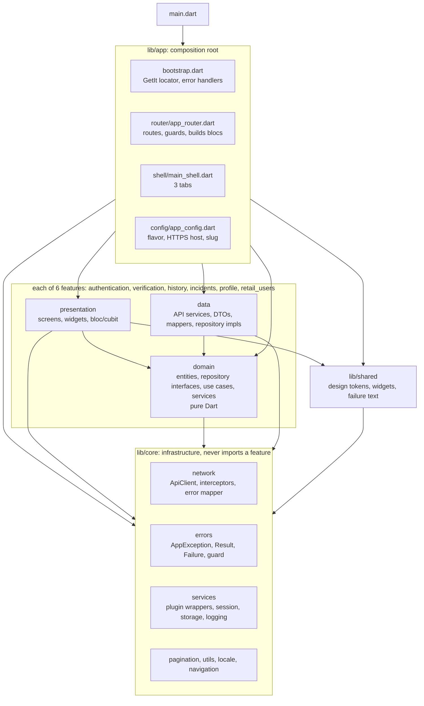

# Production audit

The production-grade review of the app, done on the `production` branch one area at a time. Each area is checked read only first. Its findings are listed here, then fixed one by one on request. Each fix gets its normal, edge and worst-case tests first.

| Step | Area | State |
|---|---|---|
| 2 | High-level architecture | Checked 2026-11-24: P-1 … P-11 |
| 3 | The central API | To do |
| 4 | Low-level architecture | To do |
| 5 | Dead code | To do |
| 6+ | Comments, data layer, UI components, state and lifecycle, security, build and release, monitoring, tests, localisation, performance, docs | To do |

**Severity:**
- **must:** a production risk;
- **should:** breaks a rule of `final.md` or makes the code inconsistent;
- **nice:** an improvement.

---

## Step 2: high-level architecture (2026-11-24)

### How it was checked
- A script read every `import` in the 177 hand-written files in `lib/` (799 links, generated files left out). It checked them against the layer rules of `final.md` §3, §4 and §11:

  | Rule | What it checks |
  |---|---|
  | R1, R2 | `core` and `shared` never import a feature or `app` |
  | R3 | a feature never imports `app` |
  | R4 | features don't import one another, except the app-wide profile entity and Cubit (§4) |
  | R5–R7 | `presentation` never imports `data`; `domain` never imports `data` or `presentation`; `data` never imports `presentation` |
  | R8, R9 | `domain` is pure Dart: no Flutter, no Flutter-importing file, no package beyond `meta`, `freezed_annotation`, `json_annotation`, `collection`, `clock`, `timezone`, `intl` |
  | R10 | plugins are used only in `core` |
  | R11 | `get_it` is used only in `app` |
  | R12 | `dio` is used only in `core`, `data` and `app` |
  | R13 | each feature file lives in `data`, `domain` or `presentation` |

- The following were read by hand:
  - the composition root (`lib/app/bootstrap.dart`) and the router (`lib/app/router/`);
  - the config (`lib/app/config/app_config.dart`, `config/*.json`);
  - the error types (`lib/core/errors/`);
  - how each bloc reaches its data;
  - where models are turned into entities;
  - where screens navigate.

### The architecture as it is



**A request and its error, end to end:**

```text
Screen ──event──▶ Bloc/Cubit ──▶ UseCase ──▶ Repository (domain interface)
                                                  │ implemented in data by
                                                  ▼
                                    RepositoryImpl ── guard(() …) ──▶ ApiService ──▶ ApiClient (Dio)
                                                                                      │ interceptors:
                                                                                      │ bodiless → auth (bearer, one renewal)
                                                                                      │ → logging (redacted) → [mock routing]
                                                                                      ▼
                                                                                   server
Answer:  envelope → DTO → mapper → entity → Success(entity) → bloc state → screen
Error:   DioException → error_mapper → AppException (sealed, 15 kinds)
         → guard → Err(Failure) → bloc state → Failure.message(l10n) (shared/extensions)
         or the screen's own text first (e.g. lookupFailureMessage) → screen
```

### What is already production grade (keep)
- **The layer rules hold:**
  - R1–R3 and R5–R13 have **0 breaks**;
  - `domain` is pure Dart in every feature;
  - `presentation` never touches `data`;
  - `core` and `shared` never import a feature;
  - every import uses the `package:` style, with no relative imports.
- **The composition root:** one `GetIt` locator, used only in `lib/app/`. Every service is registered against its interface, and features receive interfaces or callbacks.
- **Plugins:** every plugin sits behind a `core/services` interface. No plugin type (for example `MobileScannerController`) leaks out of `core`, and the tests replace them all with fakes.
- **Errors:**
  - one sealed `AppException` set, one `Result`/`Failure`, and one `guard`, which also turns a wrongly shaped answer into a failure, so no screen waits forever;
  - no `throw` in `domain` or `presentation`;
  - the failure text is central in `shared/extensions/failure_message.dart`, with screen-specific text on top.
- **Global error handlers:** `FlutterError.onError` and `PlatformDispatcher.onError` are set in `bootstrap.dart`.
- **Config:**
  - flavor, host and slug are checked at start;
  - only HTTPS is accepted;
  - the `live` placeholder is refused;
  - Postman mock routing is refused outside the `mock` build.
- **Routing:**
  - route paths are known only to `app/router`, and features use `RouteNames`;
  - the redirect logic is a pure, tested `RouteGuard`;
  - permission-gated paths are guarded, the parameterised session path included.

### Findings

#### P-1 (should): the layer rules are not tested automatically
**Evidence:** the rules above were checked with a one-off script. Nothing in `test/` or CI stops a new import from breaking them.

**Proposal:** an architecture test, `test/architecture/layer_rules_test.dart`. It reads `lib/` and fails on any break of R1–R13, with the allowed exceptions listed in the test itself (the app-wide profile entity and Cubit, §4).

**Tests:**
- **normal:** the current tree passes, except the P-2 link, which is marked as known until P-2 is fixed;
- **edge:** a generated file or an `export` line is handled correctly;
- **worst:** sample files that break each rule are each reported with the file and the rule.

#### P-2 (should): Profile imports History's `CheckTotalsCubit`
**Evidence:**
- `features/profile/presentation/screens/profile_screen.dart:6` imports `features/history/presentation/bloc/check_totals_cubit.dart`;
- it finds the cubit with `context.read` (line 67) and builds it with `BlocBuilder<CheckTotalsCubit, …>` (line 221);
- the router puts the cubit above the screen only for `history:own`.

This is the only feature-to-feature link outside the allowed profile exception (rule R4, `final.md` §4). It also hides the dependency: nothing in the screen's constructor says it needs it.

**Proposal:** the router builds the totals card from History and hands it to `ProfileScreen` as a slot (for example `Widget? totals`). Profile then knows nothing of History.

**Tests:**
- **normal:** with `history:own` the totals show;
- **edge:** without it there is no card and no `GET checks`;
- **worst:** a failed or `429` totals load shows its message, and the rest of Profile still works.

These run alongside the existing Profile flows, and the P-1 test no longer marks the link as known.

#### P-3 (should): three verification cubits skip their use cases
**Evidence:**
- every bloc in the app reaches data only through use cases, except `ScanSessionCubit`, `SerialStackCubit` and `SessionsCubit`, which take the `VerificationRepository` itself;
- they call `getFormats` and `session` although use cases for them exist (`GetFormats`, `GetSession`, used elsewhere);
- they also call `scan`, `serials`, `endSession` and `sessions`, which have no use case.

**Proposal:**
- add `ScanItem`, `CheckSerials`, `EndSession` and `GetSessions` to `verification_usecases.dart`;
- have the three cubits take only use cases, so all 14 blocs follow one pattern;
- update the router's wiring.

**Tests:**
- **normal:** a unit test for each new use case;
- **edge:** each one passes its arguments unchanged, including a session ID;
- **worst:** each passes a failure through untouched (a `429` with `Retry-After`, a network loss);
- the existing cubit tests and the scanner, stack and sessions flows pass unchanged.

#### P-4 (should): permission keys are plain text in 25 places
**Evidence:**
- `'item:lookup'`, `'item:bulk_lookup'`, `'history:own'` and `'incident:report'` are written out in `app_router.dart` (6), `main_shell.dart` (6), `profile_screen.dart` (8), `verify_screen.dart` (4) and `lookup_result_screen.dart` (1);
- a typo would compile and silently hide a feature.

**Proposal:**
- one list of the keys in the profile domain;
- plain getters on the profile's permissions (`canLookup`, `canBulkLookup`, `canReadHistory`, `canReport`);
- every place reads those.

**Tests:**
- **normal:** each getter for its key;
- **edge:** an empty set grants nothing, and `history:all` and `retail_user:add` grant nothing (§7);
- **worst:** an unknown key, or a key in a different case, grants nothing;
- the permission flows pass unchanged.

#### P-5 (should): models become entities in two different ways
**Evidence:**
- history, profile and verification convert in `data/mappers/*_mapper(s).dart` (extensions with `toEntity()`);
- incidents, retail_users and authentication build entities inside the repository (for example `incident_repository_impl.dart:40-43`).

**Proposal:** a `data/mappers/` file for each of the three, so repositories only call, guard and return.

**Tests:**
- **normal:** a mapper unit test for each mapper with a full answer;
- **edge:** optional fields missing or `null`;
- **worst:** an unknown status or role value is never shown as a valid one (§3);
- the repository tests pass unchanged.

#### P-6 (should): `app_router.dart` does too much (641 lines)
**Evidence:** one file holds:
- the route table;
- the bloc for every route, built from the locator (44 `locator` calls);
- the cross-feature callbacks (result, reports, sessions, profile);
- the pushed-page permission check.

That makes it the largest file in `app/`.

**Proposal:**
- split it by area into `app/router/routes/` (auth, check, history, reports, profile and shell);
- `app_router.dart` keeps only the `GoRouter`, the guard and the list of route groups;
- no change in behaviour.

**Tests:**
- **normal:** a new test lists every `RouteNames` value with its path and checks that each resolves;
- **edge:** the parameterised `/history/sessions/:id`;
- **worst:** a deep link to a gated route without the permission goes Home;
- all router, guard and flow tests pass unchanged.

#### P-7 (nice): seven plugin wrappers keep the interface and the plugin in one file
**Evidence:**
- `connectivity_service.dart`, `app_info_service.dart`, `launcher_service.dart`, `photo_service.dart`, `permission_service.dart`, `scanner_service.dart` and `preferences_service.dart` each hold the interface and the plugin implementation;
- storage, logging and session keep them in separate files;
- the screens that import the interface (for example `verify_screen.dart` → `scanner_service.dart`) therefore also pull in the plugin's library.

**Proposal:** split each into `<x>_service.dart` (the interface) and `<plugin>_<x>_service.dart` (the implementation), like storage. Only `bootstrap.dart` imports the implementations.

**Tests:**
- a P-1 rule, "presentation and shared import no file that imports a plugin", fails before the split and passes after;
- analyze and all tests pass.

#### P-8 (nice): `core/network` and `core/services/session` depend on each other
**Evidence:**
- `core/network/auth_interceptor.dart` imports the session interface;
- `core/services/session/dio_session_service.dart` (the Dio implementation of renewal and logout) imports `core/network/api_envelope.dart` and `error_mapper.dart`;
- there is no file cycle, but the two folders depend on each other.

**Proposal:** move `dio_session_service.dart` to `core/network/`, so network depends on the session interface and never the other way.

**Tests:**
- a P-1 rule, "no folder cycle inside `core`", fails before and passes after;
- the session tests (renewal, one renewal for many requests, logout) pass unchanged.

#### P-9 (nice): screens navigate in two ways
**Evidence:**
- 8 screens call `go_router` themselves with `RouteNames`: login, forgot and reset password, change password, verify, lookup result, my reports, report incident;
- others get callbacks from the router: scanner mode, serial stack, profile;
- both are allowed (§11), but the rule for choosing between them is not written down.

**Proposal (your decision):**
- write the rule down: a screen may push a `RouteNames` route that needs no object from another feature, and anything that needs one goes through a router callback;
- check the 8 screens against it.

No change is needed where they already comply.

#### P-10 (must, your decision): no crash reporting in a release build
**Evidence:**
- `core/services/monitoring/crash_reporting_service.dart` has only the interface and `NoOpCrashReportingService`;
- `bootstrap.dart` always uses the no-op one, so in production, crashes caught by the global handlers are only printed to the phone's log and nobody sees them;
- its comment points to "final.md Section 2.2 / 20.3", which no longer exist.

**Proposal:** choose a service (the comment names Firebase Crashlytics, which needs a Firebase project from Ziska), then implement it behind the existing interface for `staging` and `live`, keeping the no-op one for `mock`. It's handled with the monitoring step, after your choice.

#### P-11 (should, later): comments point to sections of `final.md` that no longer exist
**Evidence:**
- 197 "Section N.N" references in 116 files of `lib/`;
- about 133 of them name a section that `final.md` no longer has (for example `bootstrap.dart:62`, "Sections 4.2, 5.9"; `final.md` now has §4 and §5 with no subsections);
- the trace from the code to the spec is broken.

**Proposal:** handled in the **comments step**. Each reference is pointed at the current section, or replaced with the backend decision (`D17`, guide §) it really follows.

### Noticed for later steps (not architecture)
- `config/live.json` still holds placeholders. The app correctly refuses to start with them, but the live host and slug are needed from the backend (**build and release** step).
- There are empty folders in the working tree, not in git: `features/incidents/data/mappers`, `features/incidents/presentation/widgets` and `features/retail_users/presentation/screens` (**dead code** step).
- The release build is signed with the debug key (**build and release** step).
